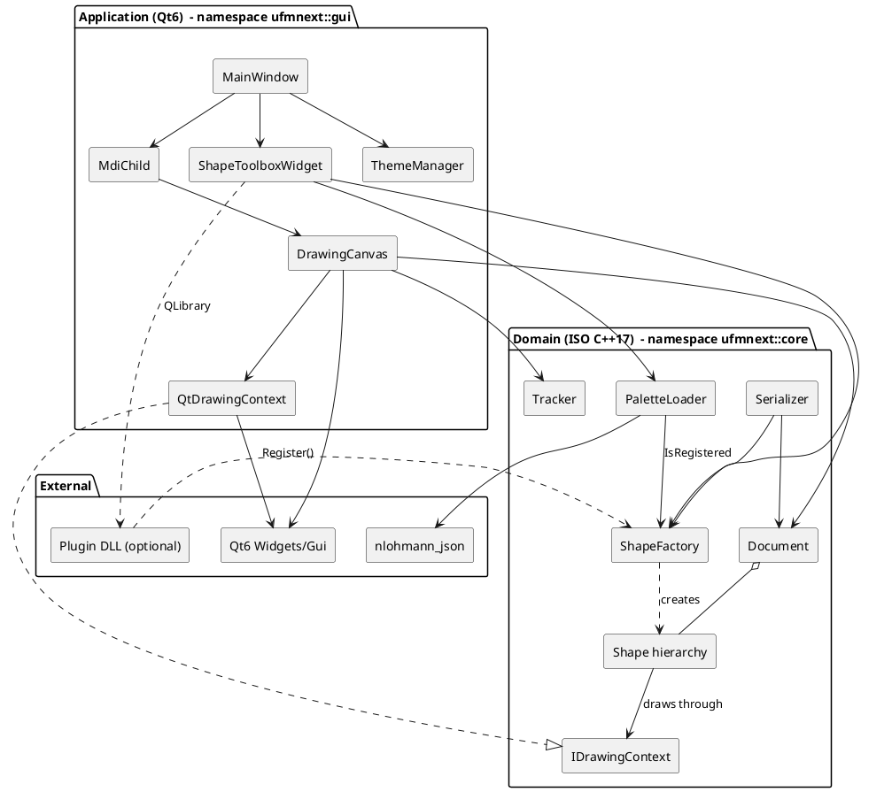
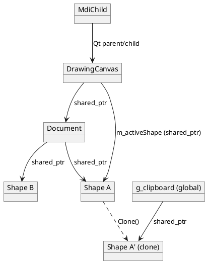
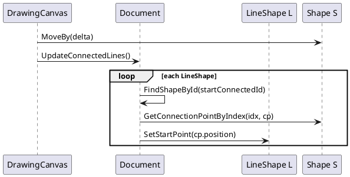
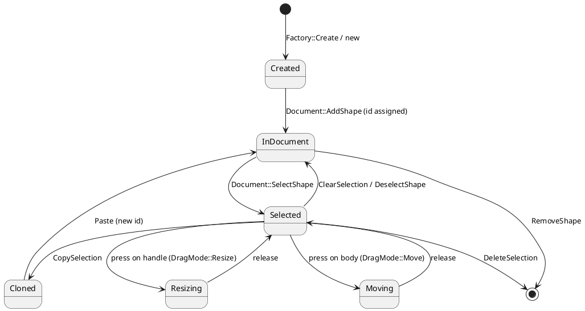
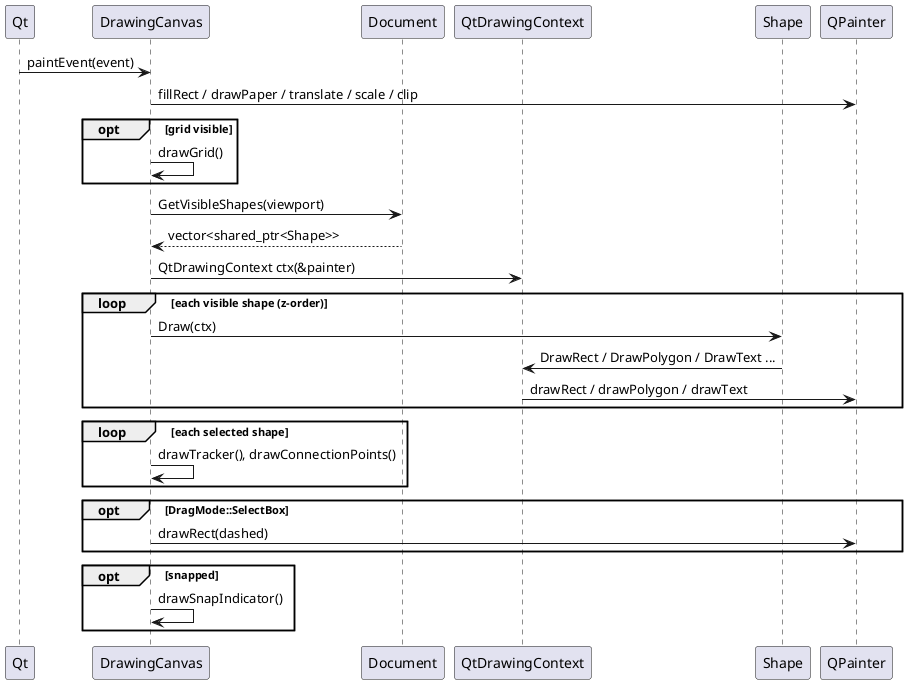
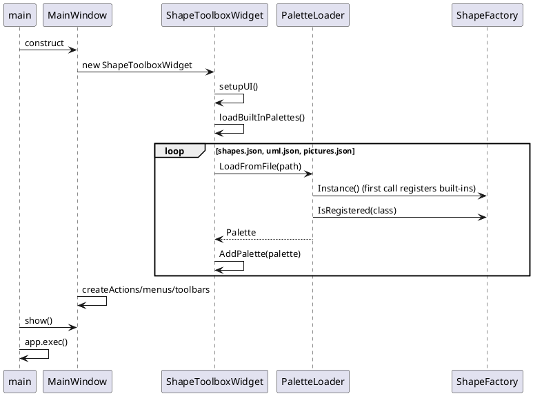

# 2. Architecture Document

## 2.1 Goals and principles

| Goal | How it is achieved |
|------|--------------------|
| Testable domain logic | `core` has zero Qt dependency; tests link only `ufmnext_core` |
| Replaceable rendering back-end | Shapes draw through the abstract `IDrawingContext` (Dependency Inversion) |
| Open for new shapes | `Shape` base class + `ShapeFactory` registry + plugins (Open/Closed) |
| Data-driven UI | Palettes are JSON files, not code |
| Safe ownership | `std::shared_ptr<Shape>` in the document, `std::unique_ptr<Shape>` from `Clone()` |

## 2.2 Layered view



Dependency rule: arrows never go from `core` to `gui` or to Qt.

## 2.3 Core class diagram

```plantuml
@startuml
skinparam classAttributeIconSize 0
namespace ufmnext.core {
  struct Point { +x: double; +y: double; +DistanceTo(Point): double }
  struct Rect { +x,y,width,height: double; +Normalized(): Rect; +Contains(Point): bool; +Intersects(Rect): bool; +Inflated(dx,dy): Rect }
  struct Color { +r,g,b,a: uint8_t; +FromHex(string): Color; +ToHex(bool): string }
  struct ConnectionPoint { +index: int; +ownerShapeId: uint64_t; +position: Point; +normal: Point; +location: AnchorLocation }

  interface IDrawingContext {
    +DrawRect(...)
    +DrawRoundedRect(...)
    +DrawCircle(...)
    +DrawEllipse(...)
    +DrawLine(...)
    +DrawPolygon(...)
    +DrawText(...)
  }

  abstract class Shape {
    #m_id: uint64_t
    #m_position: Point
    #m_width, m_height: double
    #m_outlineColor, m_fillColor, m_fontColor: Color
    #m_fillEnabled, m_visible, m_selected: bool
    #m_text: string
    #m_fontSize, m_strokeWidth: double
    +{abstract} Draw(IDrawingContext&)
    +{abstract} GetType(): ShapeType
    +{abstract} Clone(): unique_ptr<Shape>
    +GetClassName(): string
    +GetBoundingBox(): Rect
    +HitTest(Point, tol): bool
    +GetConnectionPoints(): vector<ConnectionPoint>
    +MoveBy(Point)
    #DrawTextContent(ctx, bounds)
  }
  class SquareShape
  class RoundRectangleShape { -m_cornerRadius }
  class CircleShape
  class OvalShape
  class StarShape { -m_points }
  class ArrowShape { -m_direction }
  class LineShape {
    -m_startCap, m_endCap: LineCapStyle
    -m_startConnectedShapeId, m_endConnectedShapeId: uint64_t
    -m_startAnchorIndex, m_endAnchorIndex: int
    +SetStartPoint(Point); +SetEndPoint(Point)
  }
  abstract class UmlShapeBase
  abstract class PictureShapeBase
  class UmlClassShape
  class HousePictureShape

  Shape <|-- SquareShape
  Shape <|-- RoundRectangleShape
  Shape <|-- CircleShape
  Shape <|-- OvalShape
  Shape <|-- StarShape
  Shape <|-- ArrowShape
  Shape <|-- LineShape
  Shape <|-- UmlShapeBase
  Shape <|-- PictureShapeBase
  UmlShapeBase <|-- UmlClassShape
  PictureShapeBase <|-- HousePictureShape

  class Document {
    -m_paperSize: PaperSize
    -m_shapes: vector<shared_ptr<Shape>>
    -m_nextId: uint64_t
    -m_modified: bool
    +AddShape(); +RemoveShape(); +FindShapeAt(); +GetVisibleShapes()
    +SelectShape(); +ClearSelection(); +UpdateConnectedLines()
    +BringToFront(); +SendToBack(); +SaveAsRawData(); +LoadFromRawData()
  }
  class Tracker <<static>> {
    +GetHandles(); +HitTestHandle(); +ResizeShape(); +FindSnapAnchor()
  }
  class ShapeFactory <<singleton>> {
    -m_creators: map<string, Creator>
    +Instance(); +Register(); +Create(); +IsRegistered()
  }
  class Serializer <<static>>
  class PaletteLoader <<static>>
  class Palette { +name: string; +items: vector<PaletteItem> }
  class PaletteItem { +name; +shapeClass; +startCap; +endCap }

  Document "1" o-- "*" Shape : shared_ptr
  Shape ..> IDrawingContext : uses
  Shape ..> Rect
  Shape ..> Color
  Shape "1" *-- "*" ConnectionPoint : creates on demand
  ShapeFactory ..> Shape : creates
  Palette "1" *-- "*" PaletteItem
  PaletteLoader ..> Palette
  PaletteLoader ..> ShapeFactory
  Serializer ..> Document
  Tracker ..> Shape
}
@enduml
```

## 2.4 GUI class diagram

```plantuml
@startuml
skinparam classAttributeIconSize 0
namespace ufmnext.gui {
  class MainWindow <<QMainWindow>> {
    -m_mdiArea: QMdiArea*
    -m_toolbox: ShapeToolboxWidget*
    -m_cur*Color: core::Color
    -createActions(); -createMenus(); -createToolbars()
    +newFile(); +openFile(); +saveFile(); +exportPng()
    +onToolChanged(...)
  }
  class MdiChild <<QWidget>> {
    -m_scrollArea: QScrollArea*
    -m_canvas: DrawingCanvas*
    -m_currentFilePath: QString
    +LoadFile(); +SaveFile(); +ExportPng()
  }
  class DrawingCanvas <<QWidget>> {
    -m_document: shared_ptr<core::Document>
    -m_zoom: double
    -m_toolMode: ToolMode
    -m_dragMode: DragMode
    -m_activeShape: shared_ptr<Shape>
    -m_activeHandle: HandleId
    -m_selectBox: Rect
    -m_currentSnapResult: SnapResult
    #paintEvent(); #mousePressEvent(); #mouseMoveEvent(); #mouseReleaseEvent()
    +SetTool(); +DocToWidget(); +WidgetToDoc()
    +CopySelection(); +Paste(); +ExportToPng()
  }
  class ShapeToolboxWidget <<QWidget>> {
    -m_paletteCombo: QComboBox*
    -m_stack: QStackedWidget*
    -m_palettes: vector<PaletteView>
    +AddPalette(core::Palette)
    <<signal>> toolChanged(...)
  }
  class QtDrawingContext {
    -m_painter: QPainter*
  }
  class ThemeManager <<static>> { +ApplyTheme(AppTheme) }
  enum DragMode { None; SelectBox; Move; Resize; Create; ConnectLine }
  enum ToolMode { Select; CreateShape }
  enum AppTheme { Dark; Light; ModernBlue }

  MainWindow "1" *-- "*" MdiChild
  MainWindow "1" *-- "1" ShapeToolboxWidget
  MdiChild "1" *-- "1" DrawingCanvas
  DrawingCanvas ..> QtDrawingContext
  QtDrawingContext ..|> core.IDrawingContext
  DrawingCanvas --> core.Document
  ShapeToolboxWidget ..> core.PaletteLoader
  MainWindow ..> ThemeManager
}
@enduml
```

## 2.5 Design patterns used

| Pattern | Where | Why |
|---------|-------|-----|
| **Strategy / Bridge** | `IDrawingContext` + `QtDrawingContext` | Shapes are independent of the rendering technology; the same `Draw()` code feeds the screen, PNG export and printer |
| **Prototype** | `Shape::Clone()` | Copy/paste duplicates a shape without knowing its concrete type |
| **Factory + Registry** | `ShapeFactory` | Create shapes from a string (palette, file, plugin) |
| **Singleton** (Meyers) | `ShapeFactory::Instance()` | One registry; thread-safe initialization of the function-local `static` since C++11 |
| **Template Method** | `Shape::DrawTextContent`, virtual `HitTest` / `GetBoundingBox` defaults | Base class gives a default algorithm; derived classes override pieces |
| **Observer** | Qt signals/slots (`documentModified`, `selectionChanged`, `toolChanged`) | Decouple widgets |
| **State** | `DragMode` in `DrawingCanvas` | Mouse behavior depends on the current interaction |
| **Composite-like container** | `Document` owns `Shape`s | Uniform treatment through the base class |
| **Plugin** | `PluginApi.h` | Extend palettes without recompiling the application |
| **Static utility class** | `Tracker`, `Serializer`, `PaletteLoader` | Stateless algorithms grouped by topic |

## 2.6 Coordinate systems

```
widget pixels  --WidgetToDoc-->  document units  (paper 1200 x 1400 by default)
docX = (widgetX - margin) / zoom        widgetX = margin + docX * zoom
```

`m_margin` (40 px) surrounds the paper. In `paintEvent` the painter is translated by the margin and scaled by the
zoom, so shapes are drawn directly in document units. Hit-test tolerances and handle sizes are divided by the zoom
(`5.0 / m_zoom`) so they keep a constant on-screen size.

## 2.7 Object ownership and lifetime



- Qt widgets are owned by their Qt parent (not by smart pointers), a Qt convention.
- Domain objects are owned through `std::shared_ptr`. `DrawingCanvas::m_activeShape` shares ownership so a shape
  removed from the document during a drag cannot dangle.
- `Shape::Clone()` returns `std::unique_ptr<Shape>`; callers convert to `shared_ptr` (`std::shared_ptr<Shape>(sh->Clone())`).
- The clipboard `g_clipboard` is a file-scope `std::vector<std::shared_ptr<Shape>>` in an anonymous namespace of
  [DrawingCanvas.cpp](../src/gui/DrawingCanvas.cpp), shared by all MDI windows.

## 2.8 Connected lines

A `LineShape` stores `(shapeId, anchorIndex)` for each end. `Document::UpdateConnectedLines()` re-reads the anchor
position and moves the line end after each move/resize/add. If the target no longer exists, the end is disconnected.
`Document::RemoveShape` also disconnects lines pointing to the removed shape.



## 2.9 Shape lifecycle (state diagram)



## 2.10 Rendering architecture (sequence)



## 2.11 Application start-up (sequence)



## 2.12 Extension points

1. **New built-in shape**: derive from `Shape`, implement `Draw`, `GetType`, `Clone`; add `UFMNEXT_REGISTER(T)` in `ShapeFactory::RegisterBuiltIns`; add a line to a palette JSON; add the file to `CORE_HEADERS`/`CORE_SOURCES` in CMake.
2. **New palette**: drop a JSON in `resources/palettes` and add its name to the list in `ShapeToolboxWidget::loadBuiltInPalettes`.
3. **Plugin palette**: shared library exporting `ufmnext_register_shapes` and `ufmnext_palette_json`.
4. **New output device** (SVG, PDF...): implement `IDrawingContext`.

## 2.13 Known limitations (useful for exercises)

- `DragMode::ConnectLine` exists in the enum but is not used by the canvas yet.
- There is no undo/redo.
- `Serializer` replaces unknown shape classes by a `SquareShape`; `PaletteLoader` silently drops unknown classes.
- `Shape::Clone` implementations copy field by field (see `StarShape::Clone`) and must be updated when a field is added to `Shape`; the UML/picture macros use the copy constructor instead.
- `ExportToPng` and `Print` draw all visible shapes without the selection tracker (intended).
