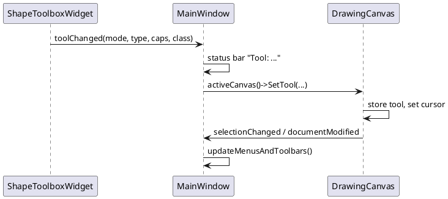

# 4. GUI API Reference (`include/ufmnext/gui`, `src/gui`)

All types are in `namespace ufmnext::gui`. Qt classes use `Q_OBJECT`, signals and slots; `CMAKE_AUTOMOC` generates the meta-object code.

## 4.1 `main()` ([main.cpp](../src/gui/main.cpp))

Creates `QApplication`, sets name/version/organization, shows one `MainWindow`, runs `app.exec()` (the Qt event loop).

## 4.2 `QtDrawingContext` ([QtDrawingContext.h](../include/ufmnext/gui/QtDrawingContext.h))

Adapter from `core::IDrawingContext` to `QPainter`.

| Member | Description |
|--------|-------------|
| `QtDrawingContext(QPainter*)` | non-owning pointer, the painter must outlive the context |
| `DrawRect`, `DrawRoundedRect`, `DrawCircle`, `DrawEllipse`, `DrawPolygon`, `DrawText` | build a `QPen`/`QBrush` from the `core::Color` and stroke width; rectangles are `Normalized()` first |
| `DrawLine` | draws the segment with round caps, then `DrawCap` for start/end; cap size = `max(10, 4 * strokeWidth)` |
| `DrawCap(pt, dir, style, color, size)` | `Arrow`: filled triangle pointing along `dir`; `Dot`: filled circle of radius `0.4 * size` |
| `static ToQColor(core::Color)`, `FromQColor(QColor)` | conversions |

Because shapes only know `IDrawingContext`, the same shape code is used for the screen (`paintEvent`), the toolbox
icons (`createShapeIcon`), `ExportToPng` and `Print`.

## 4.3 `ShapeToolboxWidget` ([ShapeToolboxWidget.h](../include/ufmnext/gui/ShapeToolboxWidget.h), [.cpp](../src/gui/ShapeToolboxWidget.cpp))

Left dock: a **Select** button, a combo box choosing the palette, a `QStackedWidget` holding one `QListWidget` (icon mode) per palette, and a **Load Plugin Palette...** button.

| Type / member | Description |
|---------------|-------------|
| `enum class ToolMode { Select, CreateShape }` | |
| `struct ToolItem` | `name, mode, shapeType, startCap, endCap, shapeClass` - what the canvas needs to create a shape |
| `struct PaletteView` (private) | `QListWidget* list` + `std::vector<ToolItem> tools`; list row *i* matches `tools[i]` |
| `AddPalette(const core::Palette&)` | builds the list: for each item, `ShapeFactory::Create` (skip if null), fills a `ToolItem`, renders an icon, appends to combo and stack |
| `SetActiveTool(ShapeType)`, `SetSelectTool()` | programmatic selection |
| signal `toolChanged(mode, type, startCap, endCap, shapeClass)` | emitted on item selection or Select button |
| slot `onItemSelectionChanged()` | maps `currentRow` to `tools[row]`, clears other palettes' selection, emits `toolChanged` |
| slot `onLoadPluginClicked()` | loads a plugin library (see 5.8) |
| `loadBuiltInPalettes()` | loads `shapes.json`, `uml.json`, `pictures.json` (see chapter 5) |
| `createShapeIcon(ToolItem)` | 44x44 pixmap: hand-drawn for built-ins, for `Custom` shapes the shape itself is created and drawn with a `QtDrawingContext` |
| `clearSelectionsExcept(QListWidget*)` | uses `QSignalBlocker` to avoid re-entrant `toolChanged` |

## 4.4 `DrawingCanvas` ([DrawingCanvas.h](../include/ufmnext/gui/DrawingCanvas.h), [DrawingCanvas.cpp](../src/gui/DrawingCanvas.cpp))

The heart of the GUI: a `QWidget` that paints a `core::Document` and turns mouse events into document changes.

### Enumeration

`DragMode { None, SelectBox, Move, Resize, Create, ConnectLine }` - current mouse interaction (`ConnectLine` is reserved).

### Data members

| Group | Members | Meaning |
|-------|---------|---------|
| Model | `m_document` | `shared_ptr<core::Document>` |
| View | `m_zoom` (0.1-5.0), `m_margin` (40), `m_showGrid`, `m_gridSpacing` (20) | |
| Tool | `m_toolMode`, `m_createShapeType`, `m_createShapeClass`, `m_createStartCap`, `m_createEndCap` | what a press creates |
| Style | `m_curOutlineColor`, `m_curFillColor`, `m_curFillEnabled`, `m_curStrokeWidth`, `m_curFontSize`, `m_curFontColor`, `m_curText` | applied to new shapes and to the primary selected shape |
| Interaction | `m_dragMode`, `m_dragStartDocPt`, `m_lastDocPt`, `m_activeHandle`, `m_originalBounds`, `m_activeShape`, `m_currentSnapResult`, `m_selectBox`, `m_pasteCount` | state of the gesture in progress |

### Public functions

| Function | Description |
|----------|-------------|
| `GetDocument()`, `SetDocument()` | model access; `SetDocument` repaints and resizes |
| `SetZoom(z)`, `ZoomIn/Out` (x/÷ 1.2), `Zoom100`, `ZoomToFit` | zoom clamped by `std::clamp`; emits `zoomChanged` |
| `SetTool(mode, type, startCap, endCap, class)` | called by `MainWindow::onToolChanged`; cursor becomes cross in create mode |
| `SetCurrent*` (outline, fill, fillEnabled, stroke, font size, font color, text) | store the default and apply to the primary selection, then `update()` and `documentModified` |
| `CopySelection`, `CutSelection`, `Paste`, `DeleteSelection`, `static HasClipboard` | clipboard (see 6.7) |
| `ExportToPng(path)`, `Print(QPrinter*)`, `ShowPrintPreview()` | render the whole paper with `QtDrawingContext` |
| `SetPaperSize(w, h)`, `SetGridVisible(b)` | |
| `DocToWidget(Point)`, `WidgetToDoc(QPointF)` | coordinate conversion |

### Signals

`zoomChanged(double)`, `mouseMoved(core::Point)`, `selectionChanged()`, `documentModified()`.

### Event handlers (protected overrides)

`paintEvent`, `mousePressEvent`, `mouseMoveEvent`, `mouseReleaseEvent`, `mouseDoubleClickEvent` (edit text through `QInputDialog`),
`wheelEvent` (Ctrl + wheel zooms by `1.15^steps`), `contextMenuEvent` (Cut/Copy/Paste/Delete), `sizeHint`.
Details: [06-gui-event-loop.md](06-gui-event-loop.md).

### Private drawing helpers

`drawPaper` (shadow + white sheet), `drawGrid` (dotted lines), `drawTracker` (dashed box + 8 white handles),
`drawConnectionPoints` (green dots), `drawSnapIndicator` (red ring with yellow fill), `updateCanvasGeometry`
(widget size = paper * zoom + 2 * margin; the surrounding `QScrollArea` provides scrolling).

## 4.5 `MdiChild` ([MdiChild.h](../include/ufmnext/gui/MdiChild.h))

One document window = `QScrollArea` + `DrawingCanvas` with its own `core::Document`.

| Member | Description |
|--------|-------------|
| `NewFile()` | title `Drawing N.ufm` using static counter `s_sequenceNumber` |
| `LoadFile(path)`, `SaveFile(path)` | via `core::Serializer`; reset modified flag |
| `ExportPng`, `PrintPreview` | forward to the canvas |
| `IsModified()` | asks the document |
| `closeEvent` / `maybeSave()` | Save/Discard/Cancel dialog; `event->ignore()` cancels closing |
| signal `documentModified()` | relays the canvas signal and updates `setWindowModified` (`[*]` placeholder) |

## 4.6 `ThemeManager` ([ThemeManager.h](../include/ufmnext/gui/ThemeManager.h))

`enum class AppTheme { Dark, Light, ModernBlue }`; `static ApplyTheme(AppTheme)` installs a Qt style sheet on the application;
`GetThemeName`. Private `get*StyleSheet()` return the CSS-like strings.

## 4.7 `MainWindow` ([MainWindow.h](../include/ufmnext/gui/MainWindow.h), [MainWindow.cpp](../src/gui/MainWindow.cpp))

Top-level `QMainWindow` with a `QMdiArea` as central widget, the toolbox dock, menus, toolbars and status bar.

| Group | Members |
|-------|---------|
| Construction | `createActions`, `createMenus`, `createToolbars`, `createToolboxDock`, `createStatusBar` |
| File slots | `newFile`, `openFile`, `saveFile`, `saveAsRawData`, `exportPng`, `printFile`, `printPreview` |
| Edit slots | `deleteSelectedShape`, `setPaperSizeDialog` (cut/copy/paste/zoom/z-order are lambdas) |
| Sync slots | `updateMenusAndToolbars` (enables actions, copies the primary selected shape's style into the toolbar widgets), `updateStatusBarCoordinates`, `onToolChanged`, `applyTheme`, `about` |
| Helpers | `activeMdiChild()`, `activeCanvas()`, `createMdiChild()` (creates the child, wires canvas signals to the window) |
| Style widgets | color buttons, fill check box, stroke/font spin boxes, text line edit, zoom combo |

`MainWindow` is the **mediator**: `ShapeToolboxWidget::toolChanged` -> `onToolChanged` -> `DrawingCanvas::SetTool` of the active child;
`DrawingCanvas::selectionChanged/documentModified` -> `updateMenusAndToolbars`.

