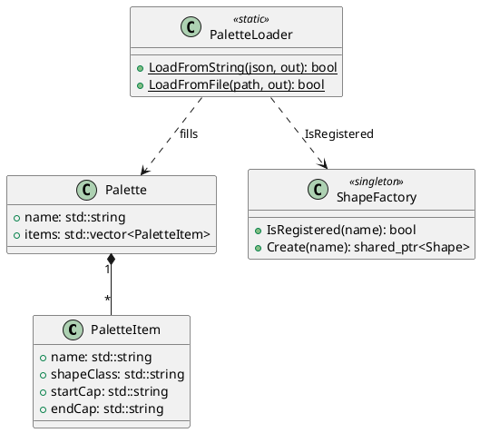
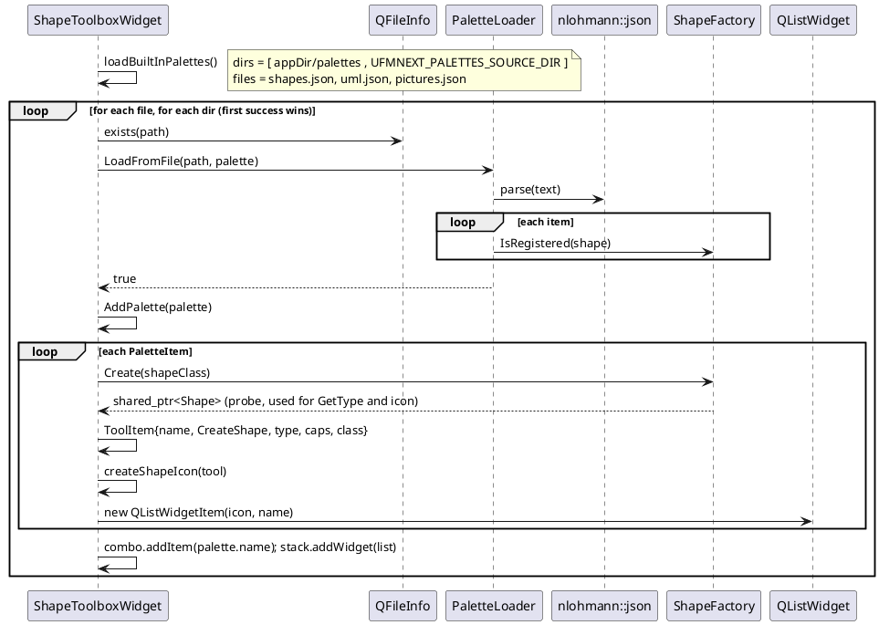
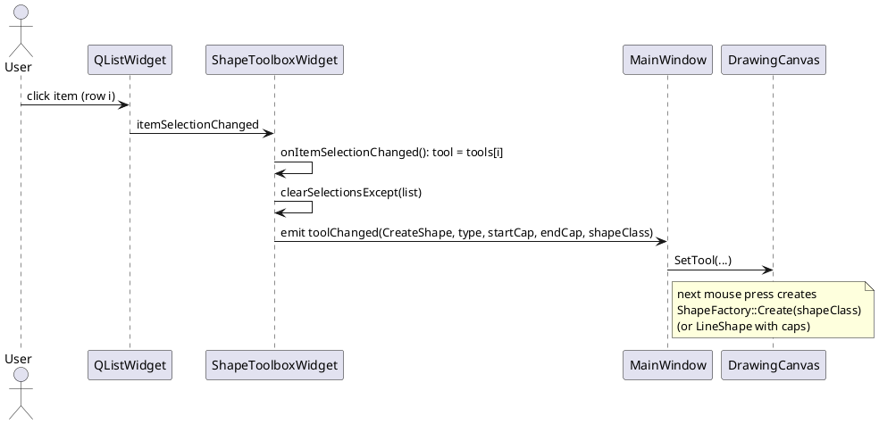
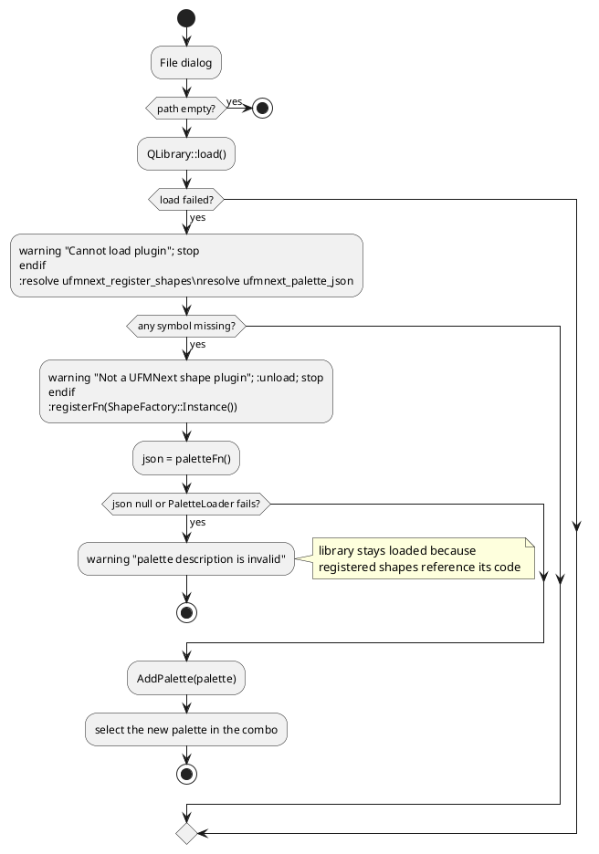

# 5. The Palette System (custom palette definition and "Load Palette" feature)

A **palette** is a named list of tools shown in the left toolbox. Each tool creates one kind of shape. Palettes are
**data** (JSON), not code: adding a tool for an existing shape class requires no recompilation.

Relevant files:

| File | Role |
|------|------|
| [Palette.h](../include/ufmnext/core/Palette.h), [Palette.cpp](../src/core/Palette.cpp) | `PaletteItem`, `Palette`, `PaletteLoader` (parse + validate JSON) |
| [ShapeFactory.h](../include/ufmnext/core/ShapeFactory.h) | class name -> shape instance |
| [ShapeToolboxWidget.cpp](../src/gui/ShapeToolboxWidget.cpp) | loads files, builds the UI, loads plugin palettes |
| [PluginApi.h](../include/ufmnext/core/PluginApi.h) | plugin contract |
| [resources/palettes](../resources/palettes) | `shapes.json`, `uml.json`, `pictures.json` |

## 5.1 JSON file description

```json
{
  "name": "<palette display name>",
  "items": [
    {
      "name":     "<tool label>",
      "shape":    "<registered C++ class name>",
      "startCap": "None | Arrow | Dot",
      "endCap":   "None | Arrow | Dot"
    }
  ]
}
```

### Palette object

| Key | Type | Required | Meaning |
|-----|------|----------|---------|
| `name` | string | **yes** | Text of the palette in the combo box |
| `items` | array of objects | **yes** | Tools, displayed in order |

### Item object

| Key | Type | Required | Default | Meaning |
|-----|------|----------|---------|---------|
| `shape` | string | **yes** | - | Derived class name as registered in `ShapeFactory` (`"StarShape"`, `"UmlClassShape"`...). Case sensitive |
| `name` | string | no | value of `shape` | Label and tooltip under the icon |
| `startCap` | string | no | `""` -> `None` | Only meaningful for `LineShape`: decoration at the start |
| `endCap` | string | no | `""` -> `None` | Same for the end |

Cap values map through `StringToLineCapStyle`: `"Arrow"`, `"Dot"`, anything else -> `None`.

### Validation rules (exactly what `PaletteLoader` does)

| Situation | Result |
|-----------|--------|
| Text is not valid JSON | `false` (the `nlohmann::json::exception` is caught) |
| Root is not an object, or `name` missing / not a string, or `items` missing / not an array | `false` |
| An item is not an object, or has no string `shape` | `false` for the **whole** palette |
| `name`, `startCap` or `endCap` present but not strings | ignored (defaults used) |
| `shape` names a class that is **not registered** | item **skipped silently**, loading continues |
| Any failure | `outPalette` is **left untouched** (the result is built in a local and moved at the end) |
| Unknown extra keys | ignored (forward compatibility) |

## 5.2 Available shape class names

| Group | Class names |
|-------|-------------|
| Basic | `SquareShape`, `RoundRectangleShape`, `CircleShape`, `OvalShape`, `LineShape`, `StarShape`, `ArrowShape` |
| UML | `UmlClassShape`, `UmlInterfaceShape`, `UmlActorShape`, `UmlUseCaseShape`, `UmlNoteShape`, `UmlPackageShape` |
| Pictures | `HousePictureShape`, `TreePictureShape`, `SunPictureShape`, `CloudPictureShape`, `MoonPictureShape`, `HeartPictureShape`, `FlowerPictureShape`, `CarPictureShape`, `BoatPictureShape`, `MountainPictureShape` |

At run time the list is `ShapeFactory::Instance().GetRegisteredNames()`.

## 5.3 Sample palettes shipped with the application

[shapes.json](../resources/palettes/shapes.json) - note that **one class can appear several times with different caps**:

```json
{
  "name": "Shapes",
  "items": [
    { "name": "Square",     "shape": "SquareShape" },
    { "name": "Round",      "shape": "RoundRectangleShape" },
    { "name": "Circle",     "shape": "CircleShape" },
    { "name": "Oval",       "shape": "OvalShape" },
    { "name": "Line",       "shape": "LineShape" },
    { "name": "Arrow Line", "shape": "LineShape", "startCap": "None", "endCap": "Arrow" },
    { "name": "Dot Line",   "shape": "LineShape", "startCap": "Dot",  "endCap": "Arrow" },
    { "name": "Star",       "shape": "StarShape" },
    { "name": "Arrow",      "shape": "ArrowShape" }
  ]
}
```

[uml.json](../resources/palettes/uml.json) - six UML tools; [pictures.json](../resources/palettes/pictures.json) - ten pictures.

### A custom palette written from scratch: `flowchart.json`

```json
{
  "name": "Flowchart",
  "items": [
    { "name": "Start / End", "shape": "OvalShape" },
    { "name": "Process",     "shape": "SquareShape" },
    { "name": "Step",        "shape": "RoundRectangleShape" },
    { "name": "Flow",        "shape": "LineShape", "endCap": "Arrow" },
    { "name": "Link",        "shape": "LineShape", "startCap": "Dot", "endCap": "Dot" },
    { "name": "Comment",     "shape": "UmlNoteShape" },
    { "name": "Ghost",       "shape": "DoesNotExistShape" }
  ]
}
```
The last item is dropped (class unknown); the palette still loads with 6 tools.

To show it in the application today: put `flowchart.json` in `resources/palettes` and add `"flowchart.json"` to the list in
`ShapeToolboxWidget::loadBuiltInPalettes()` (the file list is compiled in), or build a plugin (5.8) that returns the JSON.

## 5.4 Data model (class diagram)



## 5.5 The loading code, line by line

```cpp
bool PaletteLoader::LoadFromString(const std::string& json, Palette& outPalette) {
    try {
        const auto doc = nlohmann::json::parse(json);               // 1. parse: throws on malformed text
        if (!doc.is_object() || !doc.contains("name") || !doc["name"].is_string() ||
            !doc.contains("items") || !doc["items"].is_array()) {   // 2. structural validation
            return false;
        }
        Palette result;                                              // 3. build in a local: strong exception guarantee
        result.name = doc["name"].get<std::string>();
        const auto& factory = ShapeFactory::Instance();
        for (const auto& item : doc["items"]) {
            if (!item.is_object() || !item.contains("shape") || !item["shape"].is_string())
                return false;                                        // 4. malformed item rejects the palette
            PaletteItem pi;
            pi.shapeClass = item["shape"].get<std::string>();
            pi.name = (item.contains("name") && item["name"].is_string())
                          ? item["name"].get<std::string>() : pi.shapeClass;   // 5. default label
            if (item.contains("startCap") && item["startCap"].is_string()) pi.startCap = item["startCap"].get<std::string>();
            if (item.contains("endCap")   && item["endCap"].is_string())   pi.endCap   = item["endCap"].get<std::string>();
            if (factory.IsRegistered(pi.shapeClass))                 // 6. keep only creatable shapes
                result.items.push_back(std::move(pi));
        }
        outPalette = std::move(result);                              // 7. commit (all or nothing)
        return true;
    } catch (const nlohmann::json::exception&) {                     // 8. no exception escapes to the UI
        return false;
    }
}

bool PaletteLoader::LoadFromFile(const std::string& path, Palette& outPalette) {
    std::ifstream in(path);
    if (!in) return false;
    std::ostringstream ss;
    ss << in.rdbuf();                                                // read the whole file
    return LoadFromString(ss.str(), outPalette);
}
```

C++ techniques: RAII (`ifstream`, `ostringstream`), exceptions for parse errors at a boundary, move semantics,
`const auto&` range-for, commit-at-the-end idiom. See [08-cpp17-teaching-guide.md](08-cpp17-teaching-guide.md).

## 5.6 From file to clickable tool (sequence)



Search order: the directory next to the executable first (copied by the CMake post-build step), then the source tree
(`UFMNEXT_PALETTES_SOURCE_DIR`, useful when running from the IDE). The first location that loads wins (`break`).

### What happens when a tool is clicked



## 5.7 Using the loader from your own code

Load a file:

```cpp
#include "ufmnext/core/Palette.h"

ufmnext::core::Palette palette;
if (ufmnext::core::PaletteLoader::LoadFromFile("flowchart.json", palette)) {
    for (const auto& item : palette.items)
        std::cout << item.name << " -> " << item.shapeClass << '\n';
} else {
    std::cerr << "invalid palette\n";
}
```

Load from a string and add it to the toolbox:

```cpp
const std::string json = R"({"name":"Mine","items":[{"name":"Dash","shape":"LineShape","endCap":"Arrow"}]})";
ufmnext::core::Palette p;
if (ufmnext::core::PaletteLoader::LoadFromString(json, p)) {
    toolbox->AddPalette(p);                 // ShapeToolboxWidget*
}
```

Create a shape from a palette item (what the canvas does):

```cpp
auto shape = ufmnext::core::ShapeFactory::Instance().Create(item.shapeClass);
if (shape) {
    shape->SetPosition(100, 100);
    document.AddShape(shape);
}
```

Unit-test style check (core only, no Qt):

```cpp
ufmnext::core::Palette p;
assert(!PaletteLoader::LoadFromString("{not json", p));                         // malformed
assert(!PaletteLoader::LoadFromString(R"({"name":"x"})", p));                   // no items
assert( PaletteLoader::LoadFromString(R"({"name":"x","items":[{"shape":"Nope"}]})", p)
        && p.items.empty());                                                    // unknown class skipped
```

## 5.8 Plugin palettes

The button **Load Plugin Palette...** loads a shared library (`.dll`, `.so`, `.dylib`) with `QLibrary`.
The plugin must be built with the same compiler and C++ runtime as UFMNext, because `Shape` objects and
`std::shared_ptr` cross the DLL boundary.

Contract ([PluginApi.h](../include/ufmnext/core/PluginApi.h)):

```cpp
extern "C" void        ufmnext_register_shapes(ufmnext::core::ShapeFactory& factory);
extern "C" const char* ufmnext_palette_json();
```

### Complete plugin example

```cpp
// triangle_plugin.cpp
#include "ufmnext/core/PluginApi.h"
#include "ufmnext/core/Shape.h"
#include <memory>

namespace {
class TriangleShape : public ufmnext::core::Shape {
public:
    void Draw(ufmnext::core::IDrawingContext& ctx) const override {
        if (!m_visible) return;
        const auto b = GetBoundingBox();
        ctx.DrawPolygon({ {b.x + b.width / 2, b.y}, {b.Right(), b.Bottom()}, {b.x, b.Bottom()} },
                        m_outlineColor, m_strokeWidth, m_fillEnabled, m_fillColor);
        DrawTextContent(ctx, b);
    }
    ufmnext::core::ShapeType GetType() const override { return ufmnext::core::ShapeType::Custom; }
    std::string GetClassName() const override { return "TriangleShape"; }
    std::unique_ptr<ufmnext::core::Shape> Clone() const override {
        return std::make_unique<TriangleShape>(*this);
    }
};
}

UFMNEXT_PLUGIN_EXPORT void ufmnext_register_shapes(ufmnext::core::ShapeFactory& factory) {
    factory.Register("TriangleShape", [] { return std::make_shared<TriangleShape>(); });
}

UFMNEXT_PLUGIN_EXPORT const char* ufmnext_palette_json() {
    return R"({ "name": "Triangles", "items": [ { "name": "Triangle", "shape": "TriangleShape" } ] })";
}
```

Important: the plugin must return `ShapeType::Custom` and a unique `GetClassName()` so that the file serializer writes
`class TriangleShape` and can recreate it (if the plugin is not loaded when the file is opened, the shape becomes a square).

### Plugin loading algorithm (`onLoadPluginClicked`)



Order matters: `Register` is called **before** the JSON is parsed, otherwise `PaletteLoader` would skip the plugin's classes as unregistered.

## 5.9 Troubleshooting

| Symptom | Cause |
|---------|-------|
| Palette missing from combo | File not found in either search folder, or invalid JSON / missing `shape` key. Not listed in `loadBuiltInPalettes` |
| Tool missing from a palette | Class name misspelled or not registered (silently skipped) |
| Arrow not displayed | `startCap`/`endCap` used on a non-line shape (ignored), or misspelled value (becomes `None`) |
| Edits to JSON not visible | The copy next to the executable wins; rebuild (post-build copy) or edit that copy |
| Plugin crash | Different compiler/runtime than the application |
