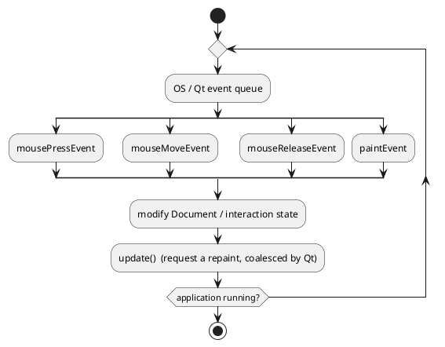
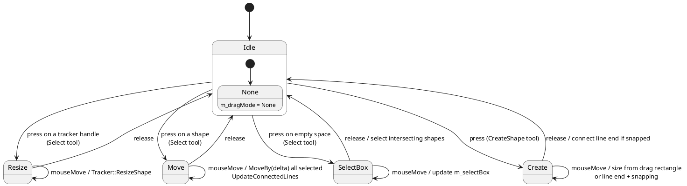
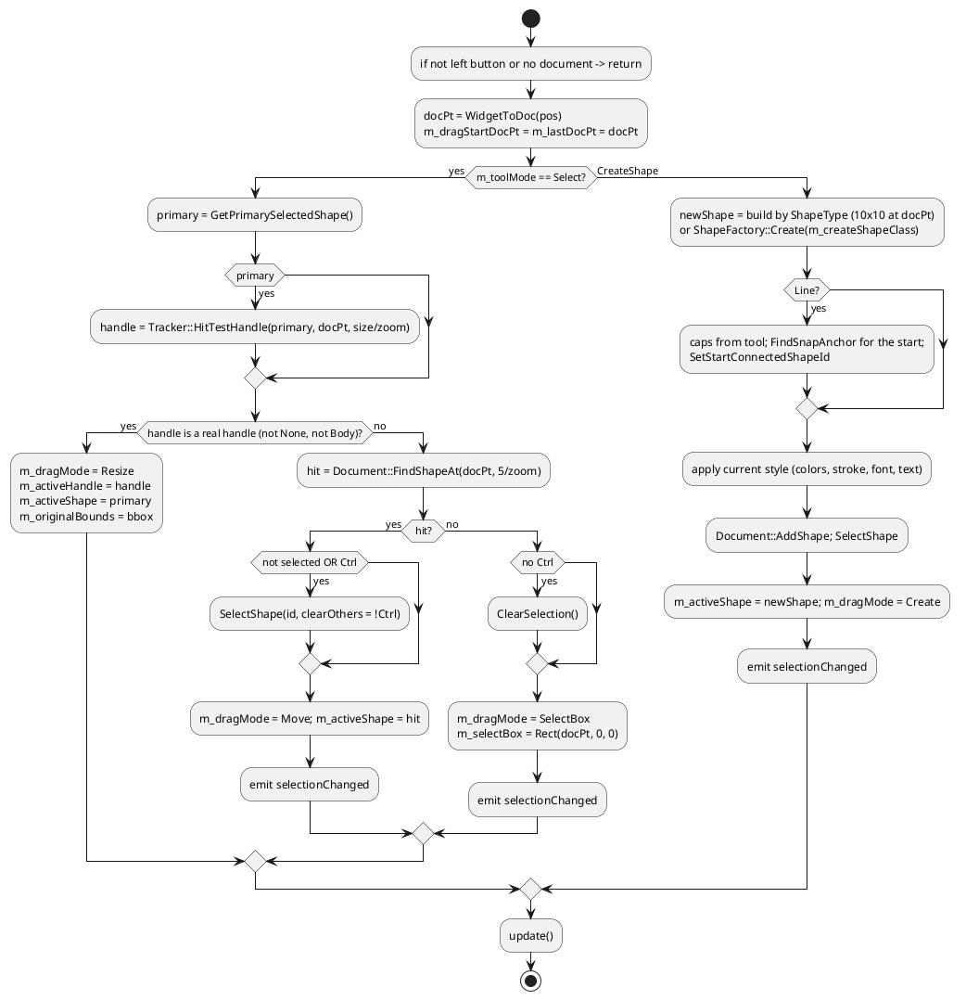
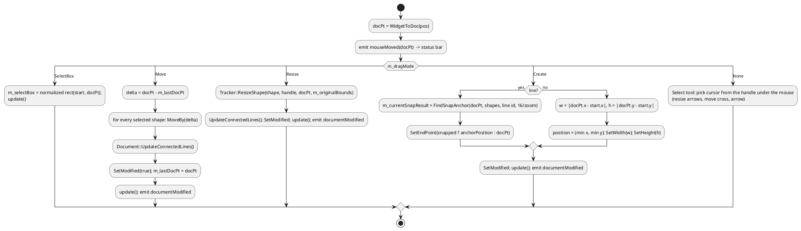
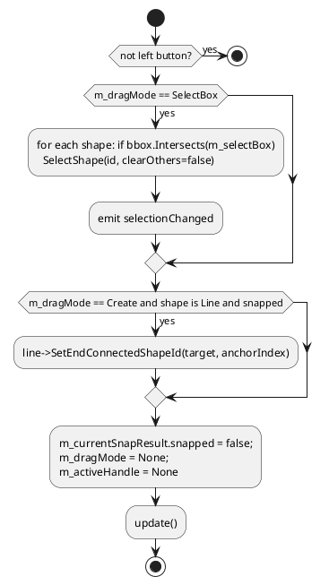
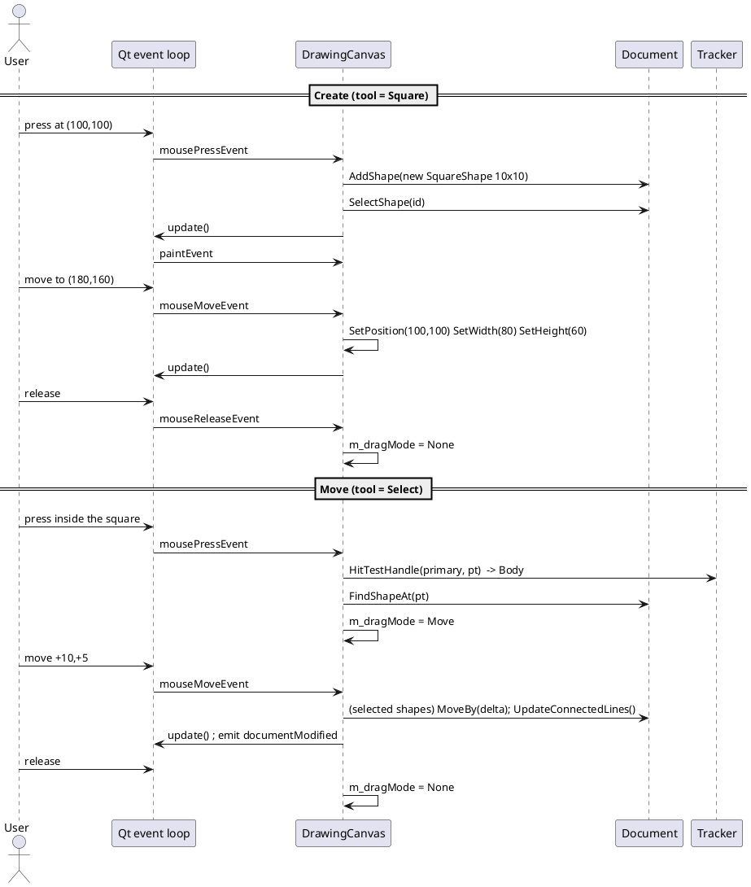
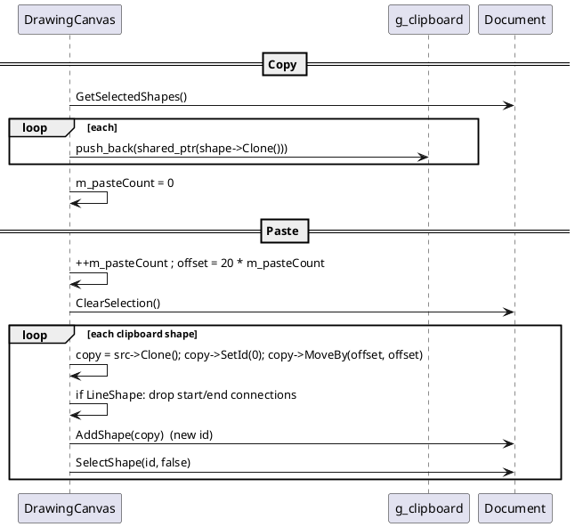

# 6. The Core GUI Drawing Loop: Mouse Events and Painting

Source: [DrawingCanvas.cpp](../src/gui/DrawingCanvas.cpp). Qt owns the main loop (`QApplication::exec()`); the canvas
reacts to events. There is no `while(true)` in the application code: the "loop" is
**event -> change the model -> `update()` -> Qt schedules `paintEvent` -> repaint**.

## 6.1 The loop at a glance



Rules to remember:

1. Event handlers **never draw**; they change data and call `update()`.
2. Only `paintEvent` draws, always from the current state of `Document` + interaction members.
3. Qt merges several `update()` calls into a single `paintEvent`.

## 6.2 Coordinates

Every handler first converts the position: `const core::Point docPt = WidgetToDoc(event->position());`

```
docX = (widgetX - m_margin) / m_zoom        (m_margin = 40, m_zoom = 0.1 .. 5.0)
```
Tolerances in pixels are divided by `m_zoom` (e.g. `5.0 / m_zoom`) so that the clickable area is constant on screen.

## 6.3 Interaction state machine

`m_toolMode` (what the toolbox chose) and `m_dragMode` (what the mouse is doing right now) together form the state.



`DragMode::ConnectLine` is declared but not used.

## 6.4 Mouse press



Key points:

- A selected shape is tested for **handle hits first**, otherwise the tracker handles (which lie on or outside the border) could never be grabbed.
- Pressing an **already selected** shape without Ctrl does not change the selection, so a multi-selection can be moved as a group.
- New shapes start at 10 x 10 and are resized by the following moves; this gives the "drag to size" feel.
- Circles are created with center `(x+5, y+5)` and radius 5.

## 6.5 Mouse move



Notes:

- `setMouseTracking(true)` in the constructor makes `mouseMoveEvent` fire even with no button pressed (needed for hover cursors and the status bar).
- **Move is incremental** (`docPt - m_lastDocPt`, then `m_lastDocPt = docPt`) while **Resize is absolute** (computed from `m_originalBounds` captured at press time).
- Because `Create` takes `abs()` of the size and `min()` of the corner, the user can drag in any direction.

## 6.5.1 Cursor feedback table

| Handle under the cursor | Cursor |
|-------------------------|--------|
| TopLeft, BottomRight | `Qt::SizeFDiagCursor` |
| TopRight, BottomLeft | `Qt::SizeBDiagCursor` |
| TopCenter, BottomCenter | `Qt::SizeVerCursor` |
| MiddleLeft, MiddleRight | `Qt::SizeHorCursor` |
| Body | `Qt::SizeAllCursor` |
| none | `Qt::ArrowCursor` |

## 6.6 Mouse release



The tool mode is **not** reset: after creating a shape, the same tool stays active so several shapes can be drawn in a row.
Clicking **Select** (button, toolbar or Edit menu) returns to selection mode.

## 6.7 Complete interaction sequence: draw then move a shape



## 6.8 The paint pass

```cpp
void DrawingCanvas::paintEvent(QPaintEvent* event) {
    QPainter painter(this);                                 // RAII: ends painting in the destructor
    painter.setRenderHint(QPainter::Antialiasing, true);
    painter.fillRect(rect(), palette().window());           // workspace background
    drawPaper(painter);                                     // shadow + white sheet (widget coords)

    // visible region in document units -> culling
    const QRect clipRect = event->rect();
    const core::Point tl = WidgetToDoc(clipRect.topLeft());
    const core::Point br = WidgetToDoc(clipRect.bottomRight());
    const core::Rect visibleDocRect(tl.x, tl.y, br.x - tl.x, br.y - tl.y);

    painter.save();
    painter.translate(m_margin, m_margin);                  // from here on: document coordinates
    painter.scale(m_zoom, m_zoom);
    painter.setClipRect(QRectF(0, 0, paper.width, paper.height));

    if (m_showGrid) drawGrid(painter);

    QtDrawingContext ctx(&painter);
    for (const auto& shape : m_document->GetVisibleShapes(visibleDocRect))
        shape->Draw(ctx);                                   // polymorphic call, z-order = vector order

    for (const auto& shape : visibleShapes)
        if (shape->IsSelected()) { drawTracker(painter, *shape); drawConnectionPoints(painter, *shape); }

    if (m_dragMode == DragMode::SelectBox) { /* dashed translucent rectangle */ }
    if (m_currentSnapResult.snapped)       drawSnapIndicator(painter, m_currentSnapResult.anchorPosition);
    painter.restore();
}
```

Layer order (bottom to top): workspace, shadow, paper, grid, shapes, trackers + anchors, rubber band, snap indicator.
Pen widths of overlays use `1.0 / m_zoom` to stay one pixel wide after the `scale`.

## 6.9 Other events

| Event | Behavior |
|-------|----------|
| `mouseDoubleClickEvent` | `FindShapeAt`; opens `QInputDialog::getText`; sets the shape text |
| `wheelEvent` | Ctrl + wheel: `SetZoom(m_zoom * 1.15^steps)`; otherwise default (scroll area scrolls) |
| `contextMenuEvent` | selects the shape under the cursor if it is not selected; menu Cut/Copy/Paste/Delete enabled by selection/clipboard |

### Clipboard sequence



## 6.10 Snapping algorithm (`Tracker::FindSnapAnchor`)

For the cursor point, iterate over all visible shapes except the one being drawn, over each one's connection points,
and keep the closest whose distance is below `snapRadius` (`16 / zoom`). Complexity $O(n \cdot a)$ with $a$ anchors per
shape. When `snapped`, the line end is placed exactly on the anchor, an indicator ring is painted, and on release the
`(shapeId, anchorIndex)` pair is stored so the line follows the shape later.

## 6.11 Debugging tips for the interaction code

- Put a breakpoint in `mousePressEvent` and inspect `m_dragMode` / `m_toolMode`.
- If a shape cannot be grabbed, check its `HitTest` and `GetBoundingBox` and the tolerance `5.0 / m_zoom`.
- If nothing repaints, check that `update()` is called (handlers never paint directly).
- If handles look huge/small when zooming, a size was not divided by `m_zoom`.
