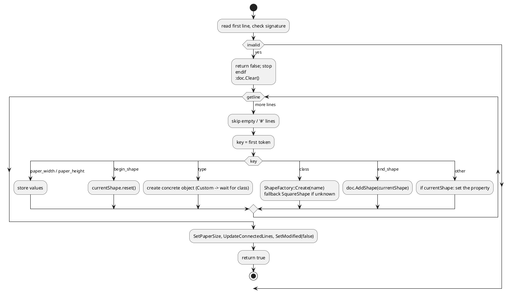

# 7. The `.ufm` Raw Drawing Format

Implemented by [Serializer.cpp](../src/core/Serializer.cpp). Human-readable, line-oriented text: one `key value` pair per line.

## 7.1 Grammar

```
file        := header paper_lines shape*
header      := "# UFMNext Raw Drawing Data v1.0" NL
paper_lines := "paper_width" SP number NL "paper_height" SP number NL "shape_count" SP integer NL
shape       := "begin_shape" NL property* "end_shape" NL
property    := key SP value NL
```
Lines that are empty or begin with `#` are skipped when reading. The first line must contain `# UFMNext Raw Drawing Data`, otherwise loading fails.

## 7.2 Common properties (every shape)

| Key | Value | Notes |
|-----|-------|-------|
| `type` | `Square`, `RoundRectangle`, `Circle`, `Oval`, `Line`, `Star`, `Arrow`, `Custom` | **must come first**: creates the object |
| `class` | factory class name | only when `type Custom`; creates the object through `ShapeFactory` |
| `id` | integer | |
| `x`, `y`, `width`, `height` | double | |
| `color`, `outline_color`, `fill_color`, `font_color` | `#AARRGGBB` | alpha first |
| `fill_enabled`, `visible` | `0` / `1` | |
| `font_size`, `stroke_width` | double | |
| `text` | escaped text up to end of line | `\\`, `\n`, `\r`, `\t` escapes |

## 7.3 Type-specific properties

| Type | Keys |
|------|------|
| RoundRectangle | `corner_radius` |
| Star | `star_points` |
| Arrow | `arrow_direction` (0 Right, 1 Left, 2 Up, 3 Down) |
| Line | `start_cap`, `end_cap` (`None/Arrow/Dot`), `start_connected_id`, `start_anchor_idx`, `end_connected_id`, `end_anchor_idx` |

## 7.4 Example

```
# UFMNext Raw Drawing Data v1.0
paper_width 1200
paper_height 1400
shape_count 3

begin_shape
type Square
id 1
x 100
y 100
width 120
height 80
color #FF000000
outline_color #FF343A40
fill_color #FFCCE5FF
fill_enabled 1
visible 1
font_size 14
font_color #FF000000
stroke_width 2
text Hello\nWorld
end_shape

begin_shape
type Custom
class UmlClassShape
id 2
x 400
y 100
width 120
height 80
...
end_shape

begin_shape
type Line
id 3
x 220
y 140
width 180
height 0
...
start_cap None
end_cap Arrow
start_connected_id 1
start_anchor_idx 1
end_connected_id 2
end_anchor_idx 3
end_shape
```

## 7.5 Reading algorithm



Notes for maintainers:

- Ids are restored by `SetId`; `Document::AddShape` then bumps `m_nextId` above the highest loaded id.
- `shape_count` is informative only (not used when reading).
- Unknown keys are ignored (forward compatible). Parsing is tolerant: invalid numbers leave the default.
- Adding a property to `Shape` requires editing **both** the writer and the reader branches.
