# 1. Overview and Build

## 1.1 What UFMNext does

- Draws vector shapes (square, rounded rectangle, circle, oval, line with caps, star, block arrow, UML shapes, pictures) on a paper sheet.
- Supports select, move, resize (tracker handles), rubber-band multi-selection, cut/copy/paste/delete, z-order, zoom, grid.
- Connects lines to shape anchors (snapping); connected lines follow their shapes.
- Saves/loads a text format (`.ufm`), exports PNG, prints.
- Shape **palettes** are described in JSON files and can be extended by plugins (shared libraries).
- Three UI themes (Dark, Light, Modern Blue).

## 1.2 Source tree

```
include/ufmnext/
  core/   Point Rect Color ShapeType ConnectionPoint IDrawingContext
          Shape SquareShape RoundRectangleShape CircleShape OvalShape LineShape StarShape ArrowShape
          UmlShapes PictureShapes
          Tracker Document Serializer ShapeFactory Palette PluginApi
  gui/    QtDrawingContext ShapeToolboxWidget DrawingCanvas MdiChild ThemeManager MainWindow
src/
  core/   *.cpp implementing the headers above (static library ufmnext_core)
  gui/    *.cpp + main.cpp (executable UFMNext)
resources/palettes/  shapes.json  uml.json  pictures.json
tests/test_main.cpp  unit tests of the core library (no Qt)
docs/                this documentation
```

## 1.3 CMake targets

| Target | Type | Content | Dependencies |
|--------|------|---------|--------------|
| `ufmnext_core` | static library | all of `core` | nlohmann_json (private) |
| `UFMNext` | WIN32 executable | all of `gui` + `main.cpp` | `ufmnext_core`, Qt6 Core/Gui/Widgets/PrintSupport |
| `ufmnext_tests` | executable | `tests/test_main.cpp` | `ufmnext_core` |

Important points of [CMakeLists.txt](../CMakeLists.txt):

- `CMAKE_CXX_STANDARD 17`, `CMAKE_CXX_EXTENSIONS OFF` (strict ISO C++, no compiler extensions).
- Warnings: `/W4 /permissive-` (MSVC) or `-Wall -Wextra -pedantic`.
- `CMAKE_AUTOMOC ON`: Qt's meta-object compiler runs automatically on headers containing `Q_OBJECT`.
- nlohmann_json is searched with `find_package`; if missing, `FetchContent` downloads v3.11.3.
- A post-build step copies `resources/palettes` to `<exe dir>/palettes`; the macro `UFMNEXT_PALETTES_SOURCE_DIR`
  points to the source folder as a fallback (see [05-palette-system.md](05-palette-system.md)).

## 1.4 Build and run

```powershell
cmake -S . -B build -G "Visual Studio 17 2022" -DCMAKE_PREFIX_PATH="C:/Qt/6.x/msvc2022_64"
cmake --build build --config Debug
ctest --test-dir build -C Debug
build\Debug\UFMNext.exe
```

## 1.5 Why two modules?

`core` contains the *domain* (shapes, document, serialization) and compiles without Qt, so it is testable with a
plain console executable and could be reused with another GUI. `gui` contains everything that needs Qt. The only
bridge is the abstract interface `core::IDrawingContext`, implemented by `gui::QtDrawingContext`.
See [02-architecture.md](02-architecture.md).
# 2. Architecture Document

## 2.1 Goals and principles

| Goal | How it is achieved |
|------|--------------------|
| Testable domain logic | `core` has zero Qt dependency; tests link only `ufmnext_core` |
| Replaceable rendering back-end | Shapes draw through the abstract `IDrawingContext` (Dependency Inversion) |
| Open for new shapes | `Shape` base class + `ShapeFactory` registry + plugins (Open/Closed) |
| Data-driven UI | Palettes are JSON files, not code |
| Safe ownership | `std::shared_ptr<Shape>` in the document, `std::unique_ptr<Shape>` from `Clone()` |

## 2.2 Layered view

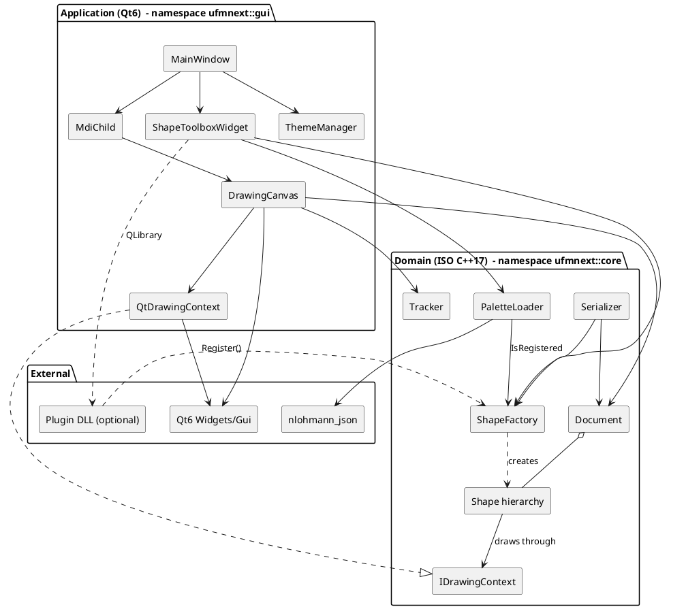

Dependency rule: arrows never go from `core` to `gui` or to Qt.

## 2.3 Core class diagram

```plantuml
@startuml
skinparam classAttributeIconSize 0
namespace ufmnext.core {
  struct Point { +x: double; +y: double; +DistanceTo(Point): double }
  struct Rect { +x,y,width,height: double; +Normalized(): Rect; +Contains(Point): bool; +Intersects(Rect): bool; +Inflated(dx,dy): Rect }
  struct Color { +r,g,b,a: uint8_t; +FromHex(string): Color; +ToHex(bool): string }
  struct ConnectionPoint { +index: int; +ownerShapeId: uint64_t; +position: Point; +normal: Point; +location: AnchorLocation }

  interface IDrawingContext {
    +DrawRect(...)
    +DrawRoundedRect(...)
    +DrawCircle(...)
    +DrawEllipse(...)
    +DrawLine(...)
    +DrawPolygon(...)
    +DrawText(...)
  }

  abstract class Shape {
    #m_id: uint64_t
    #m_position: Point
    #m_width, m_height: double
    #m_outlineColor, m_fillColor, m_fontColor: Color
    #m_fillEnabled, m_visible, m_selected: bool
    #m_text: string
    #m_fontSize, m_strokeWidth: double
    +{abstract} Draw(IDrawingContext&)
    +{abstract} GetType(): ShapeType
    +{abstract} Clone(): unique_ptr<Shape>
    +GetClassName(): string
    +GetBoundingBox(): Rect
    +HitTest(Point, tol): bool
    +GetConnectionPoints(): vector<ConnectionPoint>
    +MoveBy(Point)
    #DrawTextContent(ctx, bounds)
  }
  class SquareShape
  class RoundRectangleShape { -m_cornerRadius }
  class CircleShape
  class OvalShape
  class StarShape { -m_points }
  class ArrowShape { -m_direction }
  class LineShape {
    -m_startCap, m_endCap: LineCapStyle
    -m_startConnectedShapeId, m_endConnectedShapeId: uint64_t
    -m_startAnchorIndex, m_endAnchorIndex: int
    +SetStartPoint(Point); +SetEndPoint(Point)
  }
  abstract class UmlShapeBase
  abstract class PictureShapeBase
  class UmlClassShape
  class HousePictureShape

  Shape <|-- SquareShape
  Shape <|-- RoundRectangleShape
  Shape <|-- CircleShape
  Shape <|-- OvalShape
  Shape <|-- StarShape
  Shape <|-- ArrowShape
  Shape <|-- LineShape
  Shape <|-- UmlShapeBase
  Shape <|-- PictureShapeBase
  UmlShapeBase <|-- UmlClassShape
  PictureShapeBase <|-- HousePictureShape

  class Document {
    -m_paperSize: PaperSize
    -m_shapes: vector<shared_ptr<Shape>>
    -m_nextId: uint64_t
    -m_modified: bool
    +AddShape(); +RemoveShape(); +FindShapeAt(); +GetVisibleShapes()
    +SelectShape(); +ClearSelection(); +UpdateConnectedLines()
    +BringToFront(); +SendToBack(); +SaveAsRawData(); +LoadFromRawData()
  }
  class Tracker <<static>> {
    +GetHandles(); +HitTestHandle(); +ResizeShape(); +FindSnapAnchor()
  }
  class ShapeFactory <<singleton>> {
    -m_creators: map<string, Creator>
    +Instance(); +Register(); +Create(); +IsRegistered()
  }
  class Serializer <<static>>
  class PaletteLoader <<static>>
  class Palette { +name: string; +items: vector<PaletteItem> }
  class PaletteItem { +name; +shapeClass; +startCap; +endCap }

  Document "1" o-- "*" Shape : shared_ptr
  Shape ..> IDrawingContext : uses
  Shape ..> Rect
  Shape ..> Color
  Shape "1" *-- "*" ConnectionPoint : creates on demand
  ShapeFactory ..> Shape : creates
  Palette "1" *-- "*" PaletteItem
  PaletteLoader ..> Palette
  PaletteLoader ..> ShapeFactory
  Serializer ..> Document
  Tracker ..> Shape
}
@enduml
```

## 2.4 GUI class diagram

```plantuml
@startuml
skinparam classAttributeIconSize 0
namespace ufmnext.gui {
  class MainWindow <<QMainWindow>> {
    -m_mdiArea: QMdiArea*
    -m_toolbox: ShapeToolboxWidget*
    -m_cur*Color: core::Color
    -createActions(); -createMenus(); -createToolbars()
    +newFile(); +openFile(); +saveFile(); +exportPng()
    +onToolChanged(...)
  }
  class MdiChild <<QWidget>> {
    -m_scrollArea: QScrollArea*
    -m_canvas: DrawingCanvas*
    -m_currentFilePath: QString
    +LoadFile(); +SaveFile(); +ExportPng()
  }
  class DrawingCanvas <<QWidget>> {
    -m_document: shared_ptr<core::Document>
    -m_zoom: double
    -m_toolMode: ToolMode
    -m_dragMode: DragMode
    -m_activeShape: shared_ptr<Shape>
    -m_activeHandle: HandleId
    -m_selectBox: Rect
    -m_currentSnapResult: SnapResult
    #paintEvent(); #mousePressEvent(); #mouseMoveEvent(); #mouseReleaseEvent()
    +SetTool(); +DocToWidget(); +WidgetToDoc()
    +CopySelection(); +Paste(); +ExportToPng()
  }
  class ShapeToolboxWidget <<QWidget>> {
    -m_paletteCombo: QComboBox*
    -m_stack: QStackedWidget*
    -m_palettes: vector<PaletteView>
    +AddPalette(core::Palette)
    <<signal>> toolChanged(...)
  }
  class QtDrawingContext {
    -m_painter: QPainter*
  }
  class ThemeManager <<static>> { +ApplyTheme(AppTheme) }
  enum DragMode { None; SelectBox; Move; Resize; Create; ConnectLine }
  enum ToolMode { Select; CreateShape }
  enum AppTheme { Dark; Light; ModernBlue }

  MainWindow "1" *-- "*" MdiChild
  MainWindow "1" *-- "1" ShapeToolboxWidget
  MdiChild "1" *-- "1" DrawingCanvas
  DrawingCanvas ..> QtDrawingContext
  QtDrawingContext ..|> core.IDrawingContext
  DrawingCanvas --> core.Document
  ShapeToolboxWidget ..> core.PaletteLoader
  MainWindow ..> ThemeManager
}
@enduml
```

## 2.5 Design patterns used

| Pattern | Where | Why |
|---------|-------|-----|
| **Strategy / Bridge** | `IDrawingContext` + `QtDrawingContext` | Shapes are independent of the rendering technology; the same `Draw()` code feeds the screen, PNG export and printer |
| **Prototype** | `Shape::Clone()` | Copy/paste duplicates a shape without knowing its concrete type |
| **Factory + Registry** | `ShapeFactory` | Create shapes from a string (palette, file, plugin) |
| **Singleton** (Meyers) | `ShapeFactory::Instance()` | One registry; thread-safe initialization of the function-local `static` since C++11 |
| **Template Method** | `Shape::DrawTextContent`, virtual `HitTest` / `GetBoundingBox` defaults | Base class gives a default algorithm; derived classes override pieces |
| **Observer** | Qt signals/slots (`documentModified`, `selectionChanged`, `toolChanged`) | Decouple widgets |
| **State** | `DragMode` in `DrawingCanvas` | Mouse behavior depends on the current interaction |
| **Composite-like container** | `Document` owns `Shape`s | Uniform treatment through the base class |
| **Plugin** | `PluginApi.h` | Extend palettes without recompiling the application |
| **Static utility class** | `Tracker`, `Serializer`, `PaletteLoader` | Stateless algorithms grouped by topic |

## 2.6 Coordinate systems

```
widget pixels  --WidgetToDoc-->  document units  (paper 1200 x 1400 by default)
docX = (widgetX - margin) / zoom        widgetX = margin + docX * zoom
```

`m_margin` (40 px) surrounds the paper. In `paintEvent` the painter is translated by the margin and scaled by the
zoom, so shapes are drawn directly in document units. Hit-test tolerances and handle sizes are divided by the zoom
(`5.0 / m_zoom`) so they keep a constant on-screen size.

## 2.7 Object ownership and lifetime

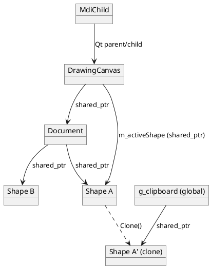

- Qt widgets are owned by their Qt parent (not by smart pointers), a Qt convention.
- Domain objects are owned through `std::shared_ptr`. `DrawingCanvas::m_activeShape` shares ownership so a shape
  removed from the document during a drag cannot dangle.
- `Shape::Clone()` returns `std::unique_ptr<Shape>`; callers convert to `shared_ptr` (`std::shared_ptr<Shape>(sh->Clone())`).
- The clipboard `g_clipboard` is a file-scope `std::vector<std::shared_ptr<Shape>>` in an anonymous namespace of
  [DrawingCanvas.cpp](../src/gui/DrawingCanvas.cpp), shared by all MDI windows.

## 2.8 Connected lines

A `LineShape` stores `(shapeId, anchorIndex)` for each end. `Document::UpdateConnectedLines()` re-reads the anchor
position and moves the line end after each move/resize/add. If the target no longer exists, the end is disconnected.
`Document::RemoveShape` also disconnects lines pointing to the removed shape.

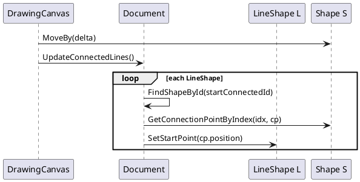

## 2.9 Shape lifecycle (state diagram)

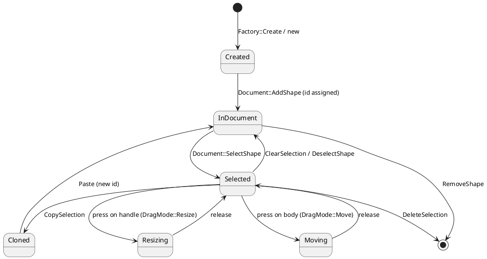

## 2.10 Rendering architecture (sequence)

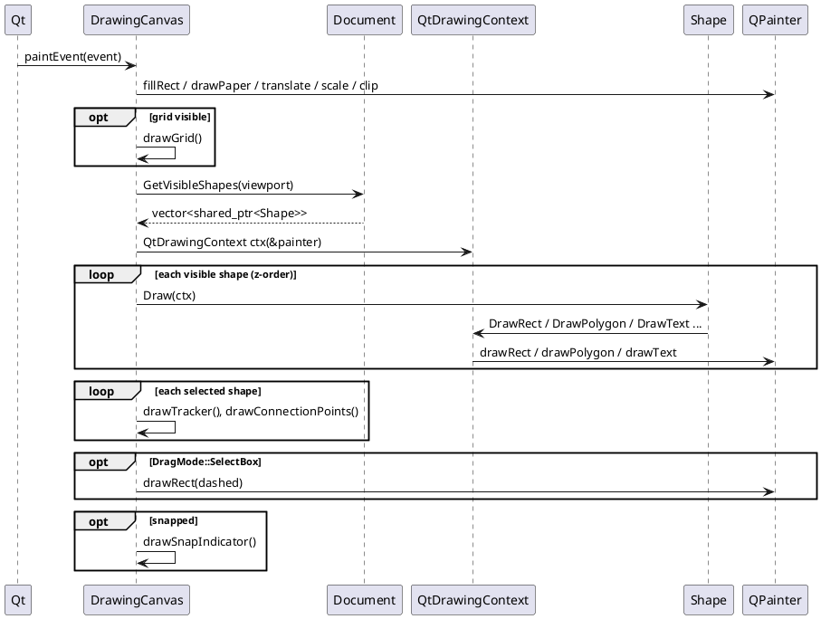

## 2.11 Application start-up (sequence)

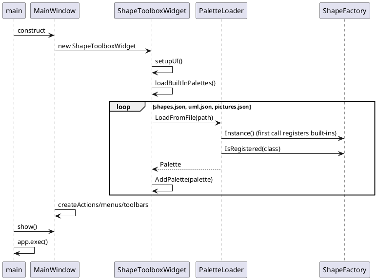

## 2.12 Extension points

1. **New built-in shape**: derive from `Shape`, implement `Draw`, `GetType`, `Clone`; add `UFMNEXT_REGISTER(T)` in `ShapeFactory::RegisterBuiltIns`; add a line to a palette JSON; add the file to `CORE_HEADERS`/`CORE_SOURCES` in CMake.
2. **New palette**: drop a JSON in `resources/palettes` and add its name to the list in `ShapeToolboxWidget::loadBuiltInPalettes`.
3. **Plugin palette**: shared library exporting `ufmnext_register_shapes` and `ufmnext_palette_json`.
4. **New output device** (SVG, PDF...): implement `IDrawingContext`.

## 2.13 Known limitations (useful for exercises)

- `DragMode::ConnectLine` exists in the enum but is not used by the canvas yet.
- There is no undo/redo.
- `Serializer` replaces unknown shape classes by a `SquareShape`; `PaletteLoader` silently drops unknown classes.
- `Shape::Clone` implementations copy field by field (see `StarShape::Clone`) and must be updated when a field is added to `Shape`; the UML/picture macros use the copy constructor instead.
- `ExportToPng` and `Print` draw all visible shapes without the selection tracker (intended).
# 3. Core API Reference (`include/ufmnext/core`, `src/core`)

All types are in `namespace ufmnext::core`. The library is built as `ufmnext_core` and has no Qt dependency.

## 3.1 Value types

### `Point` ([Point.h](../include/ufmnext/core/Point.h))
2D point/vector with `double x, y`. Header-only.

| Member | Description |
|--------|-------------|
| `Point()`, `Point(x, y)` | `noexcept` constructors |
| `operator+ - *`, `+=`, `-=` | vector arithmetic (`delta = docPt - m_lastDocPt`) |
| `operator==` | tolerance comparison (`1e-6`), never compare doubles with exact `==` |
| `DistanceTo(other)` | Euclidean distance (used by snapping and hit tests) |

### `Rect` ([Rect.h](../include/ufmnext/core/Rect.h))
`x, y, width, height`; width/height may be **negative** (a rectangle dragged right-to-left), hence `Normalized()`.

| Member | Description |
|--------|-------------|
| `Left/Right/Top/Bottom()` | edges, correct even for negative sizes |
| `Center()`, `TopLeft()` ... | helper points |
| `Normalized()` | rectangle with positive width/height |
| `Contains(pt)` | point-in-rectangle on the normalized rectangle |
| `Intersects(other)` | overlap test; used for viewport culling and rubber-band selection |
| `Inflated(dx, dy)` | grows the rectangle on every side (hit-test tolerance) |

### `Color` ([Color.h](../include/ufmnext/core/Color.h))
`uint8_t r, g, b, a`.

| Member | Description |
|--------|-------------|
| `FromHex("#RRGGBB" / "#AARRGGBB")` | parse; returns black for other lengths. 8-digit form is **alpha first** |
| `ToHex(includeAlpha)` | `#AARRGGBB` when `includeAlpha` is true |
| `Black()`, `White()`, `SoftBlue()`, ... | named constants as `static` functions (avoids static-init-order issues) |

### Enumerations ([ShapeType.h](../include/ufmnext/core/ShapeType.h))
- `ShapeType { None, Square, RoundRectangle, Circle, Oval, Line, Star, Arrow, Custom }`.
  `Custom` means "created by the factory from a class name" (UML, pictures, plugins).
- `LineCapStyle { None, Arrow, Dot }`, `TextAlignment { Center, Left, Right }`.
- Conversion helpers `ShapeTypeToString`, `StringToShapeType`, `LineCapStyleToString`, `StringToLineCapStyle`.
  They are `inline` so the header can be included from many translation units without ODR violations.

### `ConnectionPoint` and `AnchorLocation` ([ConnectionPoint.h](../include/ufmnext/core/ConnectionPoint.h))
An anchor on a shape: `index`, `ownerShapeId`, `position`, outward `normal`, `location` (`Top, Right, Bottom, Left, Center, Custom`).
Default shapes expose 5 anchors in this order: **0 Top, 1 Right, 2 Bottom, 3 Left, 4 Center**. Lines expose 2 (start, end).

## 3.2 `IDrawingContext` ([IDrawingContext.h](../include/ufmnext/core/IDrawingContext.h))

Abstract rendering interface (pure virtual, virtual destructor). One method per primitive:

`DrawRect`, `DrawRoundedRect`, `DrawCircle`, `DrawEllipse`, `DrawLine(start, end, color, width, startCap, endCap)`,
`DrawPolygon(points, ...)`, `DrawText(bounds, text, color, fontSize, align)`.

Every call receives the full style (stroke color/width, fill flag, fill color): the context is **stateless** from the
shape's point of view.

## 3.3 `Shape` ([Shape.h](../include/ufmnext/core/Shape.h), [Shape.cpp](../src/core/Shape.cpp))

Abstract base class of every drawable object.

### Pure virtual functions (must be overridden)

| Function | Role |
|----------|------|
| `void Draw(IDrawingContext&) const` | render the shape in document coordinates |
| `ShapeType GetType() const` | type identification |
| `std::unique_ptr<Shape> Clone() const` | polymorphic deep copy (Prototype) |

### Virtual functions with a default implementation

| Function | Default behavior |
|----------|------------------|
| `GetClassName()` | `ShapeTypeToString(GetType()) + "Shape"` -> `"StarShape"`; key used by `ShapeFactory`, palettes and files. Custom shapes override it |
| `GetBoundingBox()` | `Rect(position, width, height).Normalized()` |
| `HitTest(pt, tolerance)` | bounding box inflated by tolerance contains `pt`; `false` if invisible |
| `GetConnectionPoints()` | 5 anchors Top/Right/Bottom/Left/Center |
| `GetConnectionPointByIndex(i, out)` | bounds-checked access to an anchor |
| `FindClosestConnectionPoint(pt, maxDist)` | index of the nearest anchor, `-1` if none |
| `MoveBy(delta)` | `m_position += delta` |

### Properties (non-virtual accessors, `noexcept` when trivial)

| Group | Members |
|-------|---------|
| Identity | `m_id` (`0` = not yet in a document) |
| Geometry | `m_position`, `m_width`, `m_height` (`GetLength/SetLength` alias height) |
| Colors | `m_color`, `m_outlineColor`, `m_fillColor`, `m_fontColor` |
| Style | `m_fillEnabled`, `m_strokeWidth`, `m_visible` |
| Text | `m_text`, `m_fontSize` |
| UI state | `m_selected` |

`protected: DrawTextContent(ctx, bounds)` draws the text centered when it is non-empty (helper for derived classes).

Default values: size 100x100, outline `DarkGray`, fill `SoftBlue`, stroke 2, font size 12.

## 3.4 Concrete shapes

| Class | Type | Specific members | Notes |
|-------|------|------------------|-------|
| `SquareShape` | `Square` | - | `DrawRect` |
| `RoundRectangleShape` | `RoundRectangle` | `m_cornerRadius` (`Get/SetCornerRadius`) | `DrawRoundedRect` |
| `CircleShape` | `Circle` | - | constructor `(cx, cy, radius)` in the canvas |
| `OvalShape` | `Oval` | - | `DrawEllipse` |
| `StarShape` | `Star` | `m_points` (min 3); `ComputeStarVertices()` | alternates outer/inner radius (inner = 0.45 * outer), starts pointing up (`-pi/2`) |
| `ArrowShape` | `Arrow` | `m_direction` (`ArrowDirection { Right, Left, Up, Down }`); `ComputeArrowVertices()` | polygon |
| `LineShape` | `Line` | caps, connected ids, anchor indexes | see below |
| `UmlClassShape`, `UmlInterfaceShape`, `UmlActorShape`, `UmlUseCaseShape`, `UmlNoteShape`, `UmlPackageShape` | `Custom` | - | declared by macro `UFMNEXT_DECLARE_UML_SHAPE` |
| `HousePictureShape`, `TreePictureShape`, `SunPictureShape`, `CloudPictureShape`, `MoonPictureShape`, `HeartPictureShape`, `FlowerPictureShape`, `CarPictureShape`, `BoatPictureShape`, `MountainPictureShape` | `Custom` | - | declared by `UFMNEXT_DECLARE_PICTURE_SHAPE` |

### `LineShape` in detail

A line reuses the base fields: `m_position` is the **start**, `(m_width, m_height)` is the **vector start -> end**
(possibly negative). Hence:

- `GetStartPoint() = m_position`, `GetEndPoint() = m_position + (m_width, m_height)`.
- `SetStartPoint(pt)` keeps the end fixed (recomputes the vector); `SetEndPoint(pt)` only changes the vector.
- `GetBoundingBox()` is padded by `max(10, 2*stroke)` so that thin or perfectly horizontal lines remain selectable.
- `HitTest` computes the distance from the point to the **segment** (projection parameter `t` clamped to `[0,1]` with `std::clamp`).
- `GetConnectionPoints()` returns only start (index 0) and end (index 1).
- `SetStartConnectedShapeId(id, anchor)`, `SetEndConnectedShapeId(id, anchor)`, `DisconnectStart()`, `DisconnectEnd()`.

### The two ways of implementing `Clone()`

1. Hand-written (`StarShape::Clone`): builds a new object and copies each property. Easy to read, easy to forget a field.
2. Copy constructor via `std::make_unique<ClassName>(*this)` (UML/picture macros): always complete.
   Prefer this for new shapes (Rule of Zero, see [09-cpp-cookbook.md](09-cpp-cookbook.md)).

### Macro-declared shapes

```cpp
#define UFMNEXT_DECLARE_UML_SHAPE(ClassName)                           \
class ClassName : public UmlShapeBase {                                \
public:                                                                \
    ClassName();                                                       \
    void Draw(IDrawingContext& ctx) const override;                    \
    std::string GetClassName() const override { return #ClassName; }   \
    std::unique_ptr<Shape> Clone() const override {                    \
        return std::make_unique<ClassName>(*this);                     \
    }                                                                  \
};
```
`#ClassName` is the preprocessor **stringizing operator**: it turns the identifier into the string literal used as factory key.

## 3.5 `ShapeFactory` ([ShapeFactory.h](../include/ufmnext/core/ShapeFactory.h))

| Member | Description |
|--------|-------------|
| `using Creator = std::function<std::shared_ptr<Shape>()>` | any callable producing a shape |
| `static ShapeFactory& Instance()` | Meyers singleton; first call runs `RegisterBuiltIns()` |
| `bool Register(name, creator)` | `false` if name empty, creator empty or **already registered** (`std::map::emplace(...).second`) |
| `bool IsRegistered(name) const` | |
| `std::shared_ptr<Shape> Create(name) const` | `nullptr` for unknown names |
| `std::vector<std::string> GetRegisteredNames() const` | sorted (map order) |
| `std::map<std::string, Creator> m_creators` | the registry |

Built-in registration uses a local macro:

```cpp
#define UFMNEXT_REGISTER(T) Register(#T, [] { return std::make_shared<T>(); })
UFMNEXT_REGISTER(StarShape);
#undef UFMNEXT_REGISTER
```

## 3.6 `Document` ([Document.h](../include/ufmnext/core/Document.h), [Document.cpp](../src/core/Document.cpp))

The model. Owns `std::vector<std::shared_ptr<Shape>> m_shapes` (**vector order = z-order**, last = top).

| Function | Behavior |
|----------|----------|
| `AddShape(shape)` | null -> `0`; assigns `m_nextId++` if id is 0, otherwise bumps `m_nextId` above the given id; sets modified; calls `UpdateConnectedLines()`; returns the id |
| `RemoveShape(id)` | `std::find_if` + `erase`; disconnects lines that referenced the shape |
| `Clear()` | empties the vector, resets ids |
| `FindShapeById(id)` | linear search |
| `FindShapeAt(pt, tol)` | iterates with **reverse iterators** so the top-most shape wins |
| `GetVisibleShapes(viewport)` | visible and intersecting the viewport (culling) |
| `SelectShape(id, clearOthers=true)`, `DeselectShape`, `ClearSelection` | selection flag lives in the shapes |
| `GetSelectedShapes()`, `GetPrimarySelectedShape()` | primary = first selected in z-order |
| `UpdateConnectedLines()` | see [02-architecture.md](02-architecture.md#28-connected-lines) |
| `BringToFront`, `SendToBack`, `BringForward`, `SendBackward` | reorder the vector |
| `SaveAsRawData()`, `LoadFromRawData(str)` | forward to `Serializer` |
| `IsModified()`, `SetModified()` | dirty flag (title bar `*`) |
| `PaperSize` | struct with default 1200 x 1400, tolerance-based `operator==` |

Complexity: most searches are $O(n)$ in the number of shapes; acceptable for this application size.

## 3.7 `Tracker` ([Tracker.h](../include/ufmnext/core/Tracker.h), [Tracker.cpp](../src/core/Tracker.cpp))

Static helper (no state) managing selection handles and snapping.

| Type / function | Description |
|-----------------|-------------|
| `enum class HandleId { None, Body, TopLeft, TopCenter, TopRight, MiddleLeft, MiddleRight, BottomLeft, BottomCenter, BottomRight, LineStart, LineEnd }` | |
| `TrackerHandle { id, position, rect }` | a handle and its clickable square |
| `SnapResult { snapped, targetShapeId, anchorIndex, anchorPosition }` | result of a snap query |
| `DefaultHandleSize = 8.0` | `static inline` data member (C++17) |
| `GetHandles(shape, size)` | 8 handles around the bounding box, or 2 (`LineStart`, `LineEnd`) for lines |
| `HitTestHandle(shape, pt, size)` | a handle id, `Body` if the point is on the shape, else `None` |
| `ResizeShape(shape, handle, currentPt, originalBounds, keepAspect)` | recomputes the rectangle from the **original bounds** and the cursor; min size 10; lines move the matching end |
| `MoveShape(shape, delta)` | calls `shape.MoveBy` |
| `FindSnapAnchor(pt, shapes, ignoreId, radius=16)` | nearest anchor of any other visible shape within the radius |

Resizing from the original bounds (not incrementally) avoids rounding drift: the result only depends on the current
cursor.

## 3.8 `Serializer` ([Serializer.h](../include/ufmnext/core/Serializer.h))

`SerializeDocumentToRawData`, `DeserializeDocumentFromRawData`, `SaveToFile`, `LoadFromFile` (all `static`).
Format description: [07-file-format.md](07-file-format.md).

## 3.9 `Palette`, `PaletteItem`, `PaletteLoader`
Described in depth in [05-palette-system.md](05-palette-system.md).

## 3.10 `PluginApi.h`
Defines `UFMNEXT_PLUGIN_EXPORT`, the two symbol names and the function pointer types `PluginRegisterFn`, `PluginPaletteJsonFn`.
See [05-palette-system.md](05-palette-system.md#58-plugin-palettes).
# 4. GUI API Reference (`include/ufmnext/gui`, `src/gui`)

All types are in `namespace ufmnext::gui`. Qt classes use `Q_OBJECT`, signals and slots; `CMAKE_AUTOMOC` generates the meta-object code.

## 4.1 `main()` ([main.cpp](../src/gui/main.cpp))

Creates `QApplication`, sets name/version/organization, shows one `MainWindow`, runs `app.exec()` (the Qt event loop).

## 4.2 `QtDrawingContext` ([QtDrawingContext.h](../include/ufmnext/gui/QtDrawingContext.h))

Adapter from `core::IDrawingContext` to `QPainter`.

| Member | Description |
|--------|-------------|
| `QtDrawingContext(QPainter*)` | non-owning pointer, the painter must outlive the context |
| `DrawRect`, `DrawRoundedRect`, `DrawCircle`, `DrawEllipse`, `DrawPolygon`, `DrawText` | build a `QPen`/`QBrush` from the `core::Color` and stroke width; rectangles are `Normalized()` first |
| `DrawLine` | draws the segment with round caps, then `DrawCap` for start/end; cap size = `max(10, 4 * strokeWidth)` |
| `DrawCap(pt, dir, style, color, size)` | `Arrow`: filled triangle pointing along `dir`; `Dot`: filled circle of radius `0.4 * size` |
| `static ToQColor(core::Color)`, `FromQColor(QColor)` | conversions |

Because shapes only know `IDrawingContext`, the same shape code is used for the screen (`paintEvent`), the toolbox
icons (`createShapeIcon`), `ExportToPng` and `Print`.

## 4.3 `ShapeToolboxWidget` ([ShapeToolboxWidget.h](../include/ufmnext/gui/ShapeToolboxWidget.h), [.cpp](../src/gui/ShapeToolboxWidget.cpp))

Left dock: a **Select** button, a combo box choosing the palette, a `QStackedWidget` holding one `QListWidget` (icon mode) per palette, and a **Load Plugin Palette...** button.

| Type / member | Description |
|---------------|-------------|
| `enum class ToolMode { Select, CreateShape }` | |
| `struct ToolItem` | `name, mode, shapeType, startCap, endCap, shapeClass` - what the canvas needs to create a shape |
| `struct PaletteView` (private) | `QListWidget* list` + `std::vector<ToolItem> tools`; list row *i* matches `tools[i]` |
| `AddPalette(const core::Palette&)` | builds the list: for each item, `ShapeFactory::Create` (skip if null), fills a `ToolItem`, renders an icon, appends to combo and stack |
| `SetActiveTool(ShapeType)`, `SetSelectTool()` | programmatic selection |
| signal `toolChanged(mode, type, startCap, endCap, shapeClass)` | emitted on item selection or Select button |
| slot `onItemSelectionChanged()` | maps `currentRow` to `tools[row]`, clears other palettes' selection, emits `toolChanged` |
| slot `onLoadPluginClicked()` | loads a plugin library (see 5.8) |
| `loadBuiltInPalettes()` | loads `shapes.json`, `uml.json`, `pictures.json` (see chapter 5) |
| `createShapeIcon(ToolItem)` | 44x44 pixmap: hand-drawn for built-ins, for `Custom` shapes the shape itself is created and drawn with a `QtDrawingContext` |
| `clearSelectionsExcept(QListWidget*)` | uses `QSignalBlocker` to avoid re-entrant `toolChanged` |

## 4.4 `DrawingCanvas` ([DrawingCanvas.h](../include/ufmnext/gui/DrawingCanvas.h), [DrawingCanvas.cpp](../src/gui/DrawingCanvas.cpp))

The heart of the GUI: a `QWidget` that paints a `core::Document` and turns mouse events into document changes.

### Enumeration

`DragMode { None, SelectBox, Move, Resize, Create, ConnectLine }` - current mouse interaction (`ConnectLine` is reserved).

### Data members

| Group | Members | Meaning |
|-------|---------|---------|
| Model | `m_document` | `shared_ptr<core::Document>` |
| View | `m_zoom` (0.1-5.0), `m_margin` (40), `m_showGrid`, `m_gridSpacing` (20) | |
| Tool | `m_toolMode`, `m_createShapeType`, `m_createShapeClass`, `m_createStartCap`, `m_createEndCap` | what a press creates |
| Style | `m_curOutlineColor`, `m_curFillColor`, `m_curFillEnabled`, `m_curStrokeWidth`, `m_curFontSize`, `m_curFontColor`, `m_curText` | applied to new shapes and to the primary selected shape |
| Interaction | `m_dragMode`, `m_dragStartDocPt`, `m_lastDocPt`, `m_activeHandle`, `m_originalBounds`, `m_activeShape`, `m_currentSnapResult`, `m_selectBox`, `m_pasteCount` | state of the gesture in progress |

### Public functions

| Function | Description |
|----------|-------------|
| `GetDocument()`, `SetDocument()` | model access; `SetDocument` repaints and resizes |
| `SetZoom(z)`, `ZoomIn/Out` (x/÷ 1.2), `Zoom100`, `ZoomToFit` | zoom clamped by `std::clamp`; emits `zoomChanged` |
| `SetTool(mode, type, startCap, endCap, class)` | called by `MainWindow::onToolChanged`; cursor becomes cross in create mode |
| `SetCurrent*` (outline, fill, fillEnabled, stroke, font size, font color, text) | store the default and apply to the primary selection, then `update()` and `documentModified` |
| `CopySelection`, `CutSelection`, `Paste`, `DeleteSelection`, `static HasClipboard` | clipboard (see 6.7) |
| `ExportToPng(path)`, `Print(QPrinter*)`, `ShowPrintPreview()` | render the whole paper with `QtDrawingContext` |
| `SetPaperSize(w, h)`, `SetGridVisible(b)` | |
| `DocToWidget(Point)`, `WidgetToDoc(QPointF)` | coordinate conversion |

### Signals

`zoomChanged(double)`, `mouseMoved(core::Point)`, `selectionChanged()`, `documentModified()`.

### Event handlers (protected overrides)

`paintEvent`, `mousePressEvent`, `mouseMoveEvent`, `mouseReleaseEvent`, `mouseDoubleClickEvent` (edit text through `QInputDialog`),
`wheelEvent` (Ctrl + wheel zooms by `1.15^steps`), `contextMenuEvent` (Cut/Copy/Paste/Delete), `sizeHint`.
Details: [06-gui-event-loop.md](06-gui-event-loop.md).

### Private drawing helpers

`drawPaper` (shadow + white sheet), `drawGrid` (dotted lines), `drawTracker` (dashed box + 8 white handles),
`drawConnectionPoints` (green dots), `drawSnapIndicator` (red ring with yellow fill), `updateCanvasGeometry`
(widget size = paper * zoom + 2 * margin; the surrounding `QScrollArea` provides scrolling).

## 4.5 `MdiChild` ([MdiChild.h](../include/ufmnext/gui/MdiChild.h))

One document window = `QScrollArea` + `DrawingCanvas` with its own `core::Document`.

| Member | Description |
|--------|-------------|
| `NewFile()` | title `Drawing N.ufm` using static counter `s_sequenceNumber` |
| `LoadFile(path)`, `SaveFile(path)` | via `core::Serializer`; reset modified flag |
| `ExportPng`, `PrintPreview` | forward to the canvas |
| `IsModified()` | asks the document |
| `closeEvent` / `maybeSave()` | Save/Discard/Cancel dialog; `event->ignore()` cancels closing |
| signal `documentModified()` | relays the canvas signal and updates `setWindowModified` (`[*]` placeholder) |

## 4.6 `ThemeManager` ([ThemeManager.h](../include/ufmnext/gui/ThemeManager.h))

`enum class AppTheme { Dark, Light, ModernBlue }`; `static ApplyTheme(AppTheme)` installs a Qt style sheet on the application;
`GetThemeName`. Private `get*StyleSheet()` return the CSS-like strings.

## 4.7 `MainWindow` ([MainWindow.h](../include/ufmnext/gui/MainWindow.h), [MainWindow.cpp](../src/gui/MainWindow.cpp))

Top-level `QMainWindow` with a `QMdiArea` as central widget, the toolbox dock, menus, toolbars and status bar.

| Group | Members |
|-------|---------|
| Construction | `createActions`, `createMenus`, `createToolbars`, `createToolboxDock`, `createStatusBar` |
| File slots | `newFile`, `openFile`, `saveFile`, `saveAsRawData`, `exportPng`, `printFile`, `printPreview` |
| Edit slots | `deleteSelectedShape`, `setPaperSizeDialog` (cut/copy/paste/zoom/z-order are lambdas) |
| Sync slots | `updateMenusAndToolbars` (enables actions, copies the primary selected shape's style into the toolbar widgets), `updateStatusBarCoordinates`, `onToolChanged`, `applyTheme`, `about` |
| Helpers | `activeMdiChild()`, `activeCanvas()`, `createMdiChild()` (creates the child, wires canvas signals to the window) |
| Style widgets | color buttons, fill check box, stroke/font spin boxes, text line edit, zoom combo |

`MainWindow` is the **mediator**: `ShapeToolboxWidget::toolChanged` -> `onToolChanged` -> `DrawingCanvas::SetTool` of the active child;
`DrawingCanvas::selectionChanged/documentModified` -> `updateMenusAndToolbars`.

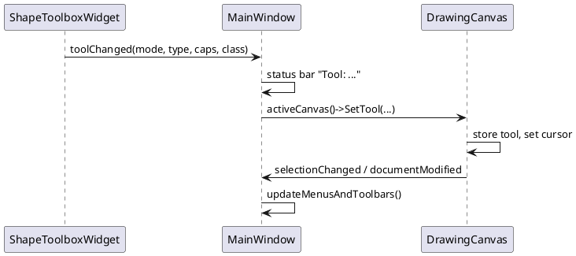
# 5. The Palette System (custom palette definition and "Load Palette" feature)

A **palette** is a named list of tools shown in the left toolbox. Each tool creates one kind of shape. Palettes are
**data** (JSON), not code: adding a tool for an existing shape class requires no recompilation.

Relevant files:

| File | Role |
|------|------|
| [Palette.h](../include/ufmnext/core/Palette.h), [Palette.cpp](../src/core/Palette.cpp) | `PaletteItem`, `Palette`, `PaletteLoader` (parse + validate JSON) |
| [ShapeFactory.h](../include/ufmnext/core/ShapeFactory.h) | class name -> shape instance |
| [ShapeToolboxWidget.cpp](../src/gui/ShapeToolboxWidget.cpp) | loads files, builds the UI, loads plugin palettes |
| [PluginApi.h](../include/ufmnext/core/PluginApi.h) | plugin contract |
| [resources/palettes](../resources/palettes) | `shapes.json`, `uml.json`, `pictures.json` |

## 5.1 JSON file description

```json
{
  "name": "<palette display name>",
  "items": [
    {
      "name":     "<tool label>",
      "shape":    "<registered C++ class name>",
      "startCap": "None | Arrow | Dot",
      "endCap":   "None | Arrow | Dot"
    }
  ]
}
```

### Palette object

| Key | Type | Required | Meaning |
|-----|------|----------|---------|
| `name` | string | **yes** | Text of the palette in the combo box |
| `items` | array of objects | **yes** | Tools, displayed in order |

### Item object

| Key | Type | Required | Default | Meaning |
|-----|------|----------|---------|---------|
| `shape` | string | **yes** | - | Derived class name as registered in `ShapeFactory` (`"StarShape"`, `"UmlClassShape"`...). Case sensitive |
| `name` | string | no | value of `shape` | Label and tooltip under the icon |
| `startCap` | string | no | `""` -> `None` | Only meaningful for `LineShape`: decoration at the start |
| `endCap` | string | no | `""` -> `None` | Same for the end |

Cap values map through `StringToLineCapStyle`: `"Arrow"`, `"Dot"`, anything else -> `None`.

### Validation rules (exactly what `PaletteLoader` does)

| Situation | Result |
|-----------|--------|
| Text is not valid JSON | `false` (the `nlohmann::json::exception` is caught) |
| Root is not an object, or `name` missing / not a string, or `items` missing / not an array | `false` |
| An item is not an object, or has no string `shape` | `false` for the **whole** palette |
| `name`, `startCap` or `endCap` present but not strings | ignored (defaults used) |
| `shape` names a class that is **not registered** | item **skipped silently**, loading continues |
| Any failure | `outPalette` is **left untouched** (the result is built in a local and moved at the end) |
| Unknown extra keys | ignored (forward compatibility) |

## 5.2 Available shape class names

| Group | Class names |
|-------|-------------|
| Basic | `SquareShape`, `RoundRectangleShape`, `CircleShape`, `OvalShape`, `LineShape`, `StarShape`, `ArrowShape` |
| UML | `UmlClassShape`, `UmlInterfaceShape`, `UmlActorShape`, `UmlUseCaseShape`, `UmlNoteShape`, `UmlPackageShape` |
| Pictures | `HousePictureShape`, `TreePictureShape`, `SunPictureShape`, `CloudPictureShape`, `MoonPictureShape`, `HeartPictureShape`, `FlowerPictureShape`, `CarPictureShape`, `BoatPictureShape`, `MountainPictureShape` |

At run time the list is `ShapeFactory::Instance().GetRegisteredNames()`.

## 5.3 Sample palettes shipped with the application

[shapes.json](../resources/palettes/shapes.json) - note that **one class can appear several times with different caps**:

```json
{
  "name": "Shapes",
  "items": [
    { "name": "Square",     "shape": "SquareShape" },
    { "name": "Round",      "shape": "RoundRectangleShape" },
    { "name": "Circle",     "shape": "CircleShape" },
    { "name": "Oval",       "shape": "OvalShape" },
    { "name": "Line",       "shape": "LineShape" },
    { "name": "Arrow Line", "shape": "LineShape", "startCap": "None", "endCap": "Arrow" },
    { "name": "Dot Line",   "shape": "LineShape", "startCap": "Dot",  "endCap": "Arrow" },
    { "name": "Star",       "shape": "StarShape" },
    { "name": "Arrow",      "shape": "ArrowShape" }
  ]
}
```

[uml.json](../resources/palettes/uml.json) - six UML tools; [pictures.json](../resources/palettes/pictures.json) - ten pictures.

### A custom palette written from scratch: `flowchart.json`

```json
{
  "name": "Flowchart",
  "items": [
    { "name": "Start / End", "shape": "OvalShape" },
    { "name": "Process",     "shape": "SquareShape" },
    { "name": "Step",        "shape": "RoundRectangleShape" },
    { "name": "Flow",        "shape": "LineShape", "endCap": "Arrow" },
    { "name": "Link",        "shape": "LineShape", "startCap": "Dot", "endCap": "Dot" },
    { "name": "Comment",     "shape": "UmlNoteShape" },
    { "name": "Ghost",       "shape": "DoesNotExistShape" }
  ]
}
```
The last item is dropped (class unknown); the palette still loads with 6 tools.

To show it in the application today: put `flowchart.json` in `resources/palettes` and add `"flowchart.json"` to the list in
`ShapeToolboxWidget::loadBuiltInPalettes()` (the file list is compiled in), or build a plugin (5.8) that returns the JSON.

## 5.4 Data model (class diagram)

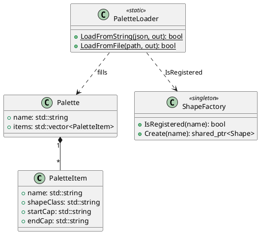

## 5.5 The loading code, line by line

```cpp
bool PaletteLoader::LoadFromString(const std::string& json, Palette& outPalette) {
    try {
        const auto doc = nlohmann::json::parse(json);               // 1. parse: throws on malformed text
        if (!doc.is_object() || !doc.contains("name") || !doc["name"].is_string() ||
            !doc.contains("items") || !doc["items"].is_array()) {   // 2. structural validation
            return false;
        }
        Palette result;                                              // 3. build in a local: strong exception guarantee
        result.name = doc["name"].get<std::string>();
        const auto& factory = ShapeFactory::Instance();
        for (const auto& item : doc["items"]) {
            if (!item.is_object() || !item.contains("shape") || !item["shape"].is_string())
                return false;                                        // 4. malformed item rejects the palette
            PaletteItem pi;
            pi.shapeClass = item["shape"].get<std::string>();
            pi.name = (item.contains("name") && item["name"].is_string())
                          ? item["name"].get<std::string>() : pi.shapeClass;   // 5. default label
            if (item.contains("startCap") && item["startCap"].is_string()) pi.startCap = item["startCap"].get<std::string>();
            if (item.contains("endCap")   && item["endCap"].is_string())   pi.endCap   = item["endCap"].get<std::string>();
            if (factory.IsRegistered(pi.shapeClass))                 // 6. keep only creatable shapes
                result.items.push_back(std::move(pi));
        }
        outPalette = std::move(result);                              // 7. commit (all or nothing)
        return true;
    } catch (const nlohmann::json::exception&) {                     // 8. no exception escapes to the UI
        return false;
    }
}

bool PaletteLoader::LoadFromFile(const std::string& path, Palette& outPalette) {
    std::ifstream in(path);
    if (!in) return false;
    std::ostringstream ss;
    ss << in.rdbuf();                                                // read the whole file
    return LoadFromString(ss.str(), outPalette);
}
```

C++ techniques: RAII (`ifstream`, `ostringstream`), exceptions for parse errors at a boundary, move semantics,
`const auto&` range-for, commit-at-the-end idiom. See [08-cpp17-teaching-guide.md](08-cpp17-teaching-guide.md).

## 5.6 From file to clickable tool (sequence)

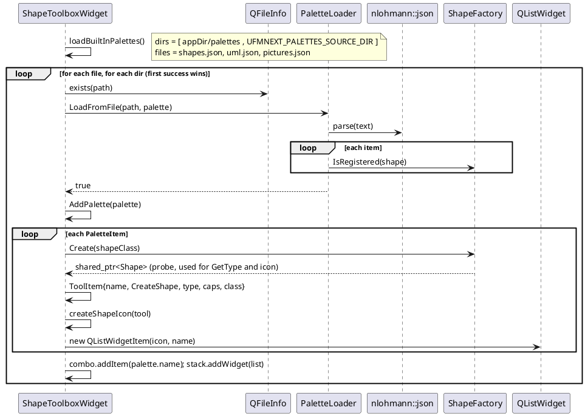

Search order: the directory next to the executable first (copied by the CMake post-build step), then the source tree
(`UFMNEXT_PALETTES_SOURCE_DIR`, useful when running from the IDE). The first location that loads wins (`break`).

### What happens when a tool is clicked

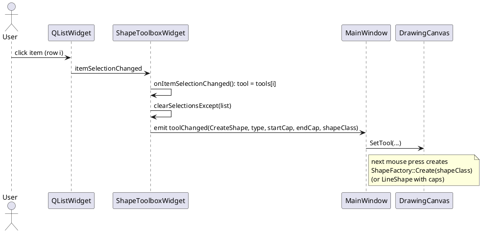

## 5.7 Using the loader from your own code

Load a file:

```cpp
#include "ufmnext/core/Palette.h"

ufmnext::core::Palette palette;
if (ufmnext::core::PaletteLoader::LoadFromFile("flowchart.json", palette)) {
    for (const auto& item : palette.items)
        std::cout << item.name << " -> " << item.shapeClass << '\n';
} else {
    std::cerr << "invalid palette\n";
}
```

Load from a string and add it to the toolbox:

```cpp
const std::string json = R"({"name":"Mine","items":[{"name":"Dash","shape":"LineShape","endCap":"Arrow"}]})";
ufmnext::core::Palette p;
if (ufmnext::core::PaletteLoader::LoadFromString(json, p)) {
    toolbox->AddPalette(p);                 // ShapeToolboxWidget*
}
```

Create a shape from a palette item (what the canvas does):

```cpp
auto shape = ufmnext::core::ShapeFactory::Instance().Create(item.shapeClass);
if (shape) {
    shape->SetPosition(100, 100);
    document.AddShape(shape);
}
```

Unit-test style check (core only, no Qt):

```cpp
ufmnext::core::Palette p;
assert(!PaletteLoader::LoadFromString("{not json", p));                         // malformed
assert(!PaletteLoader::LoadFromString(R"({"name":"x"})", p));                   // no items
assert( PaletteLoader::LoadFromString(R"({"name":"x","items":[{"shape":"Nope"}]})", p)
        && p.items.empty());                                                    // unknown class skipped
```

## 5.8 Plugin palettes

The button **Load Plugin Palette...** loads a shared library (`.dll`, `.so`, `.dylib`) with `QLibrary`.
The plugin must be built with the same compiler and C++ runtime as UFMNext, because `Shape` objects and
`std::shared_ptr` cross the DLL boundary.

Contract ([PluginApi.h](../include/ufmnext/core/PluginApi.h)):

```cpp
extern "C" void        ufmnext_register_shapes(ufmnext::core::ShapeFactory& factory);
extern "C" const char* ufmnext_palette_json();
```

### Complete plugin example

```cpp
// triangle_plugin.cpp
#include "ufmnext/core/PluginApi.h"
#include "ufmnext/core/Shape.h"
#include <memory>

namespace {
class TriangleShape : public ufmnext::core::Shape {
public:
    void Draw(ufmnext::core::IDrawingContext& ctx) const override {
        if (!m_visible) return;
        const auto b = GetBoundingBox();
        ctx.DrawPolygon({ {b.x + b.width / 2, b.y}, {b.Right(), b.Bottom()}, {b.x, b.Bottom()} },
                        m_outlineColor, m_strokeWidth, m_fillEnabled, m_fillColor);
        DrawTextContent(ctx, b);
    }
    ufmnext::core::ShapeType GetType() const override { return ufmnext::core::ShapeType::Custom; }
    std::string GetClassName() const override { return "TriangleShape"; }
    std::unique_ptr<ufmnext::core::Shape> Clone() const override {
        return std::make_unique<TriangleShape>(*this);
    }
};
}

UFMNEXT_PLUGIN_EXPORT void ufmnext_register_shapes(ufmnext::core::ShapeFactory& factory) {
    factory.Register("TriangleShape", [] { return std::make_shared<TriangleShape>(); });
}

UFMNEXT_PLUGIN_EXPORT const char* ufmnext_palette_json() {
    return R"({ "name": "Triangles", "items": [ { "name": "Triangle", "shape": "TriangleShape" } ] })";
}
```

Important: the plugin must return `ShapeType::Custom` and a unique `GetClassName()` so that the file serializer writes
`class TriangleShape` and can recreate it (if the plugin is not loaded when the file is opened, the shape becomes a square).

### Plugin loading algorithm (`onLoadPluginClicked`)

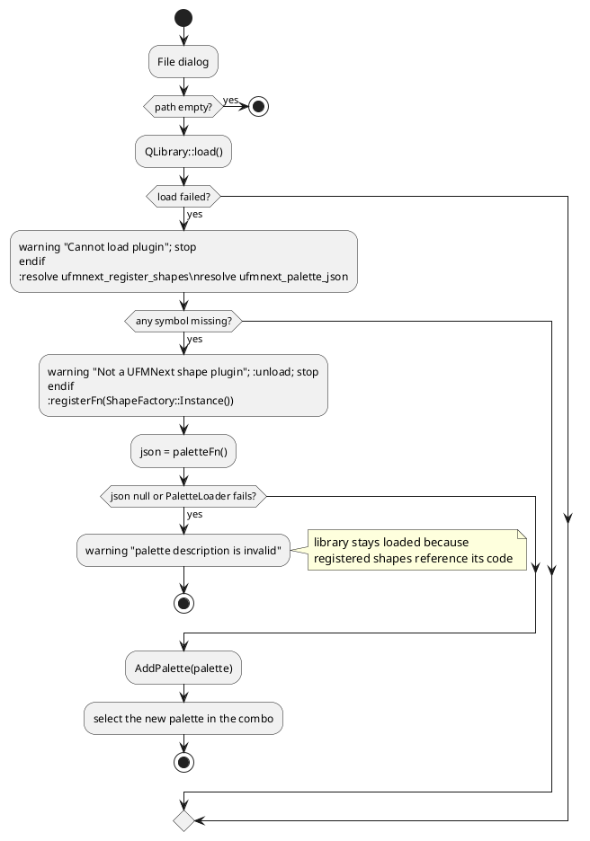

Order matters: `Register` is called **before** the JSON is parsed, otherwise `PaletteLoader` would skip the plugin's classes as unregistered.

## 5.9 Troubleshooting

| Symptom | Cause |
|---------|-------|
| Palette missing from combo | File not found in either search folder, or invalid JSON / missing `shape` key. Not listed in `loadBuiltInPalettes` |
| Tool missing from a palette | Class name misspelled or not registered (silently skipped) |
| Arrow not displayed | `startCap`/`endCap` used on a non-line shape (ignored), or misspelled value (becomes `None`) |
| Edits to JSON not visible | The copy next to the executable wins; rebuild (post-build copy) or edit that copy |
| Plugin crash | Different compiler/runtime than the application |
# 6. The Core GUI Drawing Loop: Mouse Events and Painting

Source: [DrawingCanvas.cpp](../src/gui/DrawingCanvas.cpp). Qt owns the main loop (`QApplication::exec()`); the canvas
reacts to events. There is no `while(true)` in the application code: the "loop" is
**event -> change the model -> `update()` -> Qt schedules `paintEvent` -> repaint**.

## 6.1 The loop at a glance

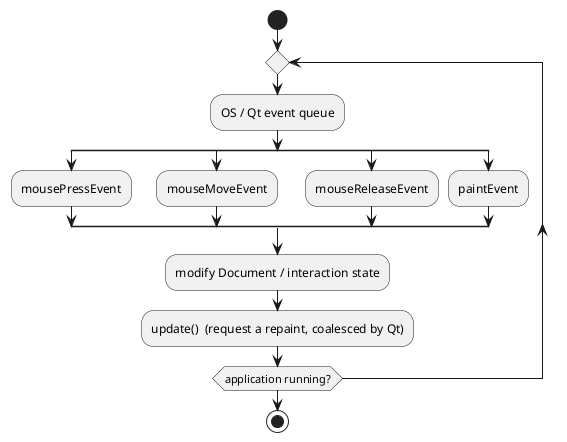

Rules to remember:

1. Event handlers **never draw**; they change data and call `update()`.
2. Only `paintEvent` draws, always from the current state of `Document` + interaction members.
3. Qt merges several `update()` calls into a single `paintEvent`.

## 6.2 Coordinates

Every handler first converts the position: `const core::Point docPt = WidgetToDoc(event->position());`

```
docX = (widgetX - m_margin) / m_zoom        (m_margin = 40, m_zoom = 0.1 .. 5.0)
```
Tolerances in pixels are divided by `m_zoom` (e.g. `5.0 / m_zoom`) so that the clickable area is constant on screen.

## 6.3 Interaction state machine

`m_toolMode` (what the toolbox chose) and `m_dragMode` (what the mouse is doing right now) together form the state.

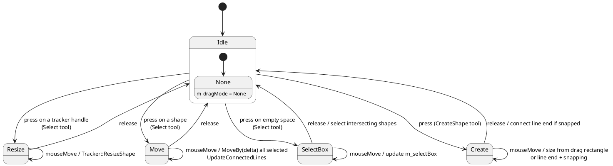

`DragMode::ConnectLine` is declared but not used.

## 6.4 Mouse press

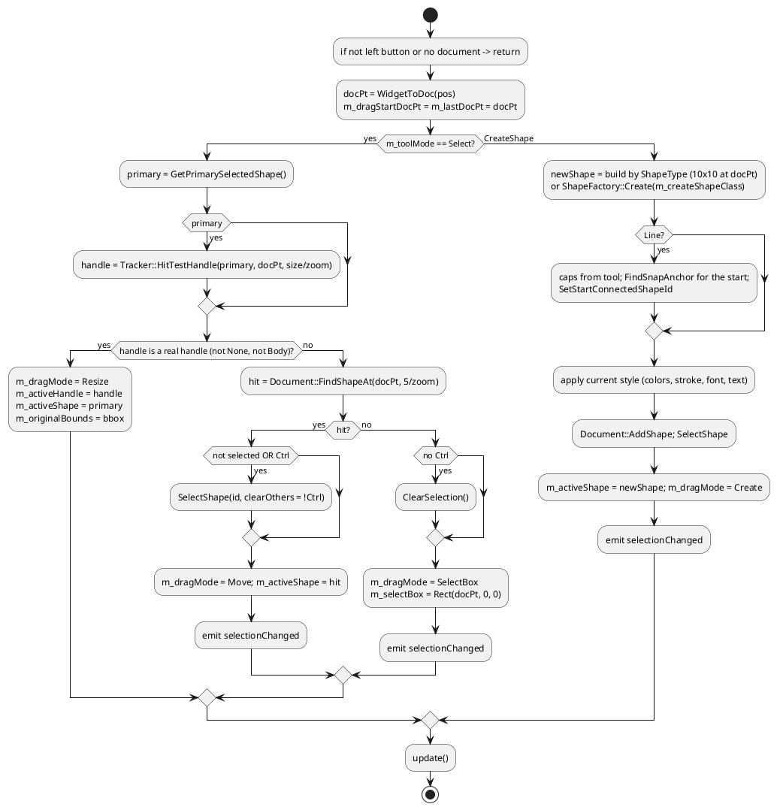

Key points:

- A selected shape is tested for **handle hits first**, otherwise the tracker handles (which lie on or outside the border) could never be grabbed.
- Pressing an **already selected** shape without Ctrl does not change the selection, so a multi-selection can be moved as a group.
- New shapes start at 10 x 10 and are resized by the following moves; this gives the "drag to size" feel.
- Circles are created with center `(x+5, y+5)` and radius 5.

## 6.5 Mouse move

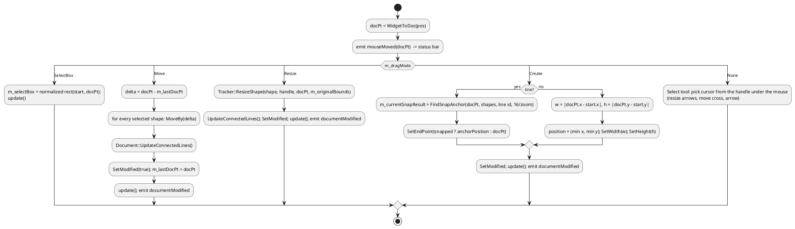

Notes:

- `setMouseTracking(true)` in the constructor makes `mouseMoveEvent` fire even with no button pressed (needed for hover cursors and the status bar).
- **Move is incremental** (`docPt - m_lastDocPt`, then `m_lastDocPt = docPt`) while **Resize is absolute** (computed from `m_originalBounds` captured at press time).
- Because `Create` takes `abs()` of the size and `min()` of the corner, the user can drag in any direction.

## 6.5.1 Cursor feedback table

| Handle under the cursor | Cursor |
|-------------------------|--------|
| TopLeft, BottomRight | `Qt::SizeFDiagCursor` |
| TopRight, BottomLeft | `Qt::SizeBDiagCursor` |
| TopCenter, BottomCenter | `Qt::SizeVerCursor` |
| MiddleLeft, MiddleRight | `Qt::SizeHorCursor` |
| Body | `Qt::SizeAllCursor` |
| none | `Qt::ArrowCursor` |

## 6.6 Mouse release

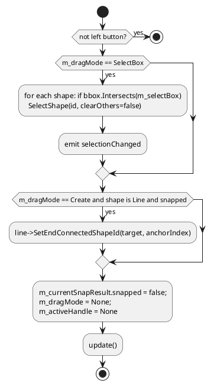

The tool mode is **not** reset: after creating a shape, the same tool stays active so several shapes can be drawn in a row.
Clicking **Select** (button, toolbar or Edit menu) returns to selection mode.

## 6.7 Complete interaction sequence: draw then move a shape

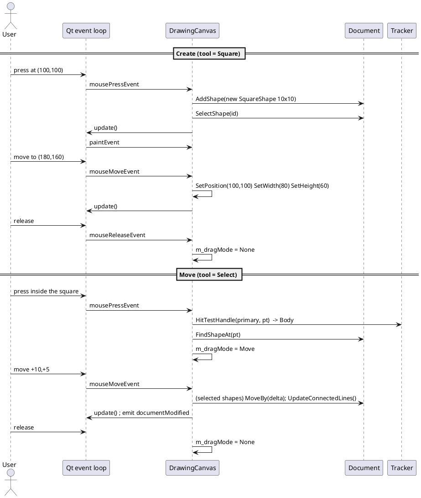

## 6.8 The paint pass

```cpp
void DrawingCanvas::paintEvent(QPaintEvent* event) {
    QPainter painter(this);                                 // RAII: ends painting in the destructor
    painter.setRenderHint(QPainter::Antialiasing, true);
    painter.fillRect(rect(), palette().window());           // workspace background
    drawPaper(painter);                                     // shadow + white sheet (widget coords)

    // visible region in document units -> culling
    const QRect clipRect = event->rect();
    const core::Point tl = WidgetToDoc(clipRect.topLeft());
    const core::Point br = WidgetToDoc(clipRect.bottomRight());
    const core::Rect visibleDocRect(tl.x, tl.y, br.x - tl.x, br.y - tl.y);

    painter.save();
    painter.translate(m_margin, m_margin);                  // from here on: document coordinates
    painter.scale(m_zoom, m_zoom);
    painter.setClipRect(QRectF(0, 0, paper.width, paper.height));

    if (m_showGrid) drawGrid(painter);

    QtDrawingContext ctx(&painter);
    for (const auto& shape : m_document->GetVisibleShapes(visibleDocRect))
        shape->Draw(ctx);                                   // polymorphic call, z-order = vector order

    for (const auto& shape : visibleShapes)
        if (shape->IsSelected()) { drawTracker(painter, *shape); drawConnectionPoints(painter, *shape); }

    if (m_dragMode == DragMode::SelectBox) { /* dashed translucent rectangle */ }
    if (m_currentSnapResult.snapped)       drawSnapIndicator(painter, m_currentSnapResult.anchorPosition);
    painter.restore();
}
```

Layer order (bottom to top): workspace, shadow, paper, grid, shapes, trackers + anchors, rubber band, snap indicator.
Pen widths of overlays use `1.0 / m_zoom` to stay one pixel wide after the `scale`.

## 6.9 Other events

| Event | Behavior |
|-------|----------|
| `mouseDoubleClickEvent` | `FindShapeAt`; opens `QInputDialog::getText`; sets the shape text |
| `wheelEvent` | Ctrl + wheel: `SetZoom(m_zoom * 1.15^steps)`; otherwise default (scroll area scrolls) |
| `contextMenuEvent` | selects the shape under the cursor if it is not selected; menu Cut/Copy/Paste/Delete enabled by selection/clipboard |

### Clipboard sequence

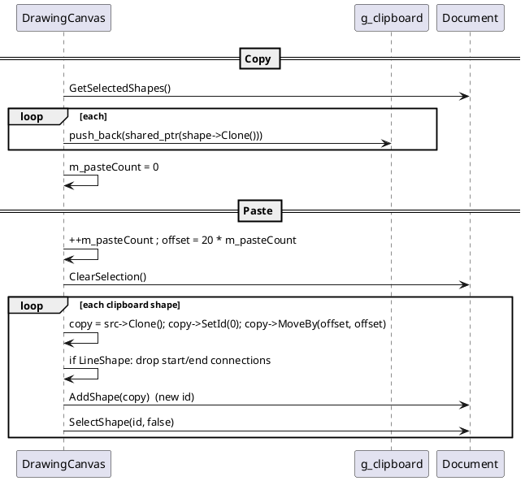

## 6.10 Snapping algorithm (`Tracker::FindSnapAnchor`)

For the cursor point, iterate over all visible shapes except the one being drawn, over each one's connection points,
and keep the closest whose distance is below `snapRadius` (`16 / zoom`). Complexity $O(n \cdot a)$ with $a$ anchors per
shape. When `snapped`, the line end is placed exactly on the anchor, an indicator ring is painted, and on release the
`(shapeId, anchorIndex)` pair is stored so the line follows the shape later.

## 6.11 Debugging tips for the interaction code

- Put a breakpoint in `mousePressEvent` and inspect `m_dragMode` / `m_toolMode`.
- If a shape cannot be grabbed, check its `HitTest` and `GetBoundingBox` and the tolerance `5.0 / m_zoom`.
- If nothing repaints, check that `update()` is called (handlers never paint directly).
- If handles look huge/small when zooming, a size was not divided by `m_zoom`.
# 7. The `.ufm` Raw Drawing Format

Implemented by [Serializer.cpp](../src/core/Serializer.cpp). Human-readable, line-oriented text: one `key value` pair per line.

## 7.1 Grammar

```
file        := header paper_lines shape*
header      := "# UFMNext Raw Drawing Data v1.0" NL
paper_lines := "paper_width" SP number NL "paper_height" SP number NL "shape_count" SP integer NL
shape       := "begin_shape" NL property* "end_shape" NL
property    := key SP value NL
```
Lines that are empty or begin with `#` are skipped when reading. The first line must contain `# UFMNext Raw Drawing Data`, otherwise loading fails.

## 7.2 Common properties (every shape)

| Key | Value | Notes |
|-----|-------|-------|
| `type` | `Square`, `RoundRectangle`, `Circle`, `Oval`, `Line`, `Star`, `Arrow`, `Custom` | **must come first**: creates the object |
| `class` | factory class name | only when `type Custom`; creates the object through `ShapeFactory` |
| `id` | integer | |
| `x`, `y`, `width`, `height` | double | |
| `color`, `outline_color`, `fill_color`, `font_color` | `#AARRGGBB` | alpha first |
| `fill_enabled`, `visible` | `0` / `1` | |
| `font_size`, `stroke_width` | double | |
| `text` | escaped text up to end of line | `\\`, `\n`, `\r`, `\t` escapes |

## 7.3 Type-specific properties

| Type | Keys |
|------|------|
| RoundRectangle | `corner_radius` |
| Star | `star_points` |
| Arrow | `arrow_direction` (0 Right, 1 Left, 2 Up, 3 Down) |
| Line | `start_cap`, `end_cap` (`None/Arrow/Dot`), `start_connected_id`, `start_anchor_idx`, `end_connected_id`, `end_anchor_idx` |

## 7.4 Example

```
# UFMNext Raw Drawing Data v1.0
paper_width 1200
paper_height 1400
shape_count 3

begin_shape
type Square
id 1
x 100
y 100
width 120
height 80
color #FF000000
outline_color #FF343A40
fill_color #FFCCE5FF
fill_enabled 1
visible 1
font_size 14
font_color #FF000000
stroke_width 2
text Hello\nWorld
end_shape

begin_shape
type Custom
class UmlClassShape
id 2
x 400
y 100
width 120
height 80
...
end_shape

begin_shape
type Line
id 3
x 220
y 140
width 180
height 0
...
start_cap None
end_cap Arrow
start_connected_id 1
start_anchor_idx 1
end_connected_id 2
end_anchor_idx 3
end_shape
```

## 7.5 Reading algorithm

```plantuml
@startuml
start
:read first line, check signature;
if (invalid) then (yes)
  :return false; stop
endif
:doc.Clear();
while (getline) is (more lines)
  :skip empty / '#' lines;
  :key = first token;
  switch (key)
  case (paper_width / paper_height)
    :store values;
  case (begin_shape)
    :currentShape.reset();
  case (type)
    :create concrete object (Custom -> wait for class);
  case (class)
    :ShapeFactory::Create(name)\nfallback SquareShape if unknown;
  case (end_shape)
    :doc.AddShape(currentShape);
  case (other)
    :if currentShape: set the property;
  endswitch
endwhile
:SetPaperSize, UpdateConnectedLines, SetModified(false);
:return true;
stop
@enduml
```

Notes for maintainers:

- Ids are restored by `SetId`; `Document::AddShape` then bumps `m_nextId` above the highest loaded id.
- `shape_count` is informative only (not used when reading).
- Unknown keys are ignored (forward compatible). Parsing is tolerant: invalid numbers leave the default.
- Adding a property to `Shape` requires editing **both** the writer and the reader branches.
# 8. Teaching Guide: Learning ISO C++17 with UFMNext

Audience: junior developers who know basic programming. Each lesson names a technique, shows where it appears in
the code, explains why, and ends with an exercise. Follow the lessons in order; read the referenced files.

Companion: [09-cpp-cookbook.md](09-cpp-cookbook.md) (index of C++ Core Guidelines and cppreference pages).

Suggested path: lessons 1-5 (week 1: language basics through the code), 6-10 (week 2: OO and ownership),
11-16 (week 3: library and modern idioms), 17-20 (week 4: architecture and tooling).

---

## Lesson 1 - Headers, include guards, namespaces

```cpp
#pragma once
namespace ufmnext::core { struct Point { double x{0.0}; double y{0.0}; }; }
```

- `#pragma once` prevents double inclusion (the portable alternative is `#ifndef` guards).
- `namespace ufmnext::core { }` is the **C++17 nested namespace** syntax (before: `namespace ufmnext { namespace core {`).
- Declarations go in `include/`, definitions in `src/`; small functions may be `inline` in the header ([ShapeType.h](../include/ufmnext/core/ShapeType.h)).

Exercise: why are `ShapeTypeToString` and `StringToShapeType` marked `inline`? (Answer: One Definition Rule, they are defined in a header included by many .cpp files.)

## Lesson 2 - Structs, default member initializers, constructors

```cpp
struct Rect {
    double x{0.0}; double y{0.0}; double width{0.0}; double height{0.0};
    Rect() noexcept = default;
    Rect(double inX, double inY, double inW, double inH) noexcept : x(inX), y(inY), width(inW), height(inH) {}
};
```

- `{0.0}` default member initializers guarantee no uninitialized fields.
- `= default` asks the compiler to generate the default constructor.
- The member initializer list (after `:`) initializes members before the constructor body runs.
- Value types (`Point`, `Rect`, `Color`) are cheap to copy and are passed by `const&`.

Exercise: add `Rect::Area()` as a `const noexcept` member.

## Lesson 3 - `const` correctness and `noexcept`

```cpp
Point GetPosition() const noexcept { return m_position; }
virtual Rect GetBoundingBox() const;
```

- A `const` member function promises not to modify the object; it can be called on `const Shape&`.
- `noexcept` documents that a function cannot throw (trivial getters/setters).
- Parameters: small types by value, big types by `const T&`, e.g. `SetText(const std::string& txt)`.

Exercise: find three functions in `Shape` that return `const std::string&` and explain the lifetime risk.

## Lesson 4 - Enumerations (`enum class`)

```cpp
enum class LineCapStyle { None = 0, Arrow, Dot };
```

Scoped enums do not leak names or convert implicitly to `int`. See conversion functions with `switch` in
[ShapeType.h](../include/ufmnext/core/ShapeType.h).

Exercise: add `LineCapStyle::Diamond` and follow the compiler to every place to update (use warnings `/W4`).

## Lesson 5 - Operator overloading and floating-point comparison

```cpp
bool operator==(const Point& o) const noexcept { return std::abs(x - o.x) < 1e-6 && std::abs(y - o.y) < 1e-6; }
Point operator-(const Point& o) const noexcept { return Point(x - o.x, y - o.y); }
```

Never compare floating point numbers with exact `==`; use a tolerance. `docPt - m_lastDocPt` reads like math.

Exercise: implement `Point operator*(double, const Point&)` as a free function.

## Lesson 6 - Inheritance, virtual functions, abstract classes

```cpp
class Shape {
public:
    virtual ~Shape() = default;
    virtual void Draw(IDrawingContext& ctx) const = 0;     // pure virtual: Shape is abstract
    virtual ShapeType GetType() const = 0;
    virtual std::unique_ptr<Shape> Clone() const = 0;
};
class StarShape : public Shape { void Draw(IDrawingContext&) const override; ... };
```

- `= 0` makes a class abstract; it cannot be instantiated.
- **Virtual destructor** is mandatory when deleting derived objects through a base pointer (Core Guidelines C.35).
- `override` makes the compiler verify that you really override (C.128). Always write it.
- Polymorphism in action: `shape->Draw(ctx)` in `paintEvent` calls the right derived function.

Exercise: remove `override` from one `Draw` and change its signature (drop `const`): what does the compiler say, with and without `override`?

## Lesson 7 - Virtual `Clone()` (Prototype) and covariant ownership

`Clone()` returns `std::unique_ptr<Shape>`: exclusive ownership transferred to the caller. In the canvas:

```cpp
g_clipboard.push_back(std::shared_ptr<core::Shape>(sh->Clone()));
```
A `unique_ptr` converts to `shared_ptr` implicitly or explicitly. Why clone? Copying a `Shape` by value through a base
reference would **slice** it (lose derived data). Compare the hand-written `StarShape::Clone` with the macro version
`std::make_unique<ClassName>(*this)`.

Exercise: add a `std::string m_tag` to `Shape`. Which `Clone()` implementations silently lose it?

## Lesson 8 - Smart pointers and ownership

| Type | Use in the project |
|------|--------------------|
| `std::shared_ptr<Shape>` | `Document::m_shapes`, clipboard, `m_activeShape` (shared ownership) |
| `std::unique_ptr<Shape>` | return value of `Clone()` |
| raw `T*` / `T&` | non-owning observation (`QPainter*`, `Shape&` parameters) |
| Qt parent/child | widgets (`new QPushButton(..., this)`) are deleted by their parent |

```cpp
auto line = std::make_shared<core::LineShape>(docPt, docPt);   // prefer make_shared / make_unique over new
```
Guideline R.20-R.23, R.30: use smart pointers to express ownership; raw pointers/references do not own.

Exercise: why does `DrawingCanvas` keep `m_activeShape` as a `shared_ptr` and not a raw pointer?

## Lesson 9 - Downcasting with `dynamic_cast`

```cpp
auto* line = dynamic_cast<core::LineShape*>(m_activeShape.get());
if (line) { line->SetEndPoint(docPt); }
```
`dynamic_cast` to a pointer returns `nullptr` on failure (checked at run time, needs RTTI and a polymorphic type).
It is used where type-specific code is unavoidable (`Document::UpdateConnectedLines`, `Serializer`, `Tracker`).
Design discussion: a virtual function would remove casts; the cost is a wider base interface. Discuss trade-offs.

Exercise: replace the `dynamic_cast<LineShape*>` in `Tracker::GetHandles` by a virtual `Shape::GetHandles()`.

## Lesson 10 - RAII and scope-based resources

- `QPainter painter(this);` begins painting in the constructor and ends in the destructor.
- `QSignalBlocker blocker(list);` blocks signals for its scope ([ShapeToolboxWidget.cpp](../src/gui/ShapeToolboxWidget.cpp)).
- `std::ifstream in(path);` closes the file automatically.
- `painter.save()` / `restore()` is the *non*-RAII counterpart: an early `return` between them would leak state. Discuss.

Rule: R.1 "Manage resources automatically using resource handles and RAII".

## Lesson 11 - Standard containers and range-based for

```cpp
for (const auto& shape : m_shapes) { if (shape && shape->IsSelected()) selected.push_back(shape); }
std::vector<std::string> names; names.reserve(m_creators.size());
```
`std::vector` is the default container (contiguous, cache friendly). `reserve` avoids reallocations.
`const auto&` avoids copying the `shared_ptr` (and its atomic reference count). `std::map` gives sorted names.

Exercise: why does `Document::FindShapeById` use a linear search? When would you add `std::unordered_map<uint64_t, ...>`?

## Lesson 12 - Algorithms and lambdas

```cpp
auto it = std::find_if(m_shapes.begin(), m_shapes.end(), [id](const auto& s) { return s && s->GetId() == id; });
if (it != m_shapes.end()) m_shapes.erase(it);
```

- `[id]` captures by value; `[this]` captures the object pointer (Qt connect lambdas).
- `const auto&` in a lambda parameter is a **generic lambda** (C++14).
- Reverse iteration `rbegin()/rend()` finds the top-most shape in `FindShapeAt`.

Exercise: rewrite `GetSelectedShapes` with `std::copy_if` and `std::back_inserter`.

## Lesson 13 - `std::function` and the registry

```cpp
using Creator = std::function<std::shared_ptr<Shape>()>;
std::map<std::string, Creator> m_creators;
Register("StarShape", [] { return std::make_shared<StarShape>(); });
```
`std::function` stores any callable (lambda, function pointer, functor). A capture-less lambda is a tiny factory.
`emplace(...).second` tells whether the insertion happened (false on duplicate key).

Exercise: register a creator that makes a `StarShape` with 8 points under the name `"Star8Shape"`.

## Lesson 14 - Singleton the modern way

```cpp
ShapeFactory& ShapeFactory::Instance() { static ShapeFactory factory; return factory; }
```
Function-local statics are initialized once and **thread-safely** since C++11 (Meyers singleton). The constructor is private.
Discuss why global mutable singletons hurt testing (tests here share the registry).

## Lesson 15 - Move semantics

```cpp
result.items.push_back(std::move(pi));
outPalette = std::move(result);
```
`std::move` casts to an rvalue so the vector steals the buffers instead of copying. Moved-from objects are valid but
unspecified. Return local variables by value; do not write `return std::move(x);`.

Exercise: find all `std::move` calls in `src/core` and say what is moved.

## Lesson 16 - Strings, streams and parsing

[Serializer.cpp](../src/core/Serializer.cpp) uses `std::ostringstream` to format and `std::istringstream` to parse (`lineStream >> key`).
`Color::ToHex` uses `std::setw`, `std::setfill`, `std::hex`. Discuss C++17 alternatives: `std::from_chars`,
`std::string_view` for non-owning parsing, `std::optional` for "no value" results.

Exercise: write `std::optional<double> ParseDouble(std::string_view)` using `std::from_chars` (MSVC and recent GCC support doubles).

## Lesson 17 - Error handling strategies

| Boundary | Strategy |
|----------|----------|
| Palette parsing | exceptions from nlohmann caught, converted to `bool` |
| Serializer | `bool` return; tolerant parser |
| Factory | `nullptr` for unknown name; callers check |
| Qt GUI | message boxes |

Guideline E.* and I.10: decide one error strategy per layer and keep it. Never let an exception cross the Qt event handler
boundary (Qt does not support exceptions thrown from slots).

Exercise: change `PaletteLoader` to return `std::optional<Palette>` and fix callers (C++17).

## Lesson 18 - Preprocessor macros: when and why

```cpp
#define UFMNEXT_REGISTER(T) Register(#T, [] { return std::make_shared<T>(); })
...
#undef UFMNEXT_REGISTER
```
`#T` stringizes. The macro is local (defined then `#undef`'d) to limit damage. Guideline ES.30-ES.31: avoid macros;
this is one of the rare justified uses (generate repetitive class declarations and keep name and string in sync).
Exercise: rewrite `UFMNEXT_REGISTER` as a function template `template<class T> void RegisterShape(const char*)` and note what you lose (the automatic string).

## Lesson 19 - Interfaces and dependency inversion

`IDrawingContext` is an **interface class**: only pure virtuals and a virtual destructor. `core` depends on the abstraction,
`gui` provides the implementation. Test idea: write a `RecordingContext : IDrawingContext` that appends call names to a
`std::vector<std::string>` and verify what `StarShape::Draw` emits - no Qt, no window needed.

Exercise: implement an `SvgDrawingContext` that writes SVG text, then export documents to SVG.

## Lesson 20 - Build system, warnings, tests

- CMake targets, `target_link_libraries` with `PUBLIC/PRIVATE`, `target_include_directories`.
- Warnings as design feedback: `/W4` or `-Wall -Wextra -pedantic`.
- `CMAKE_CXX_EXTENSIONS OFF` keeps the code ISO C++.
- A test executable registered with `add_test`, run by `ctest`.
- Qt specifics: `Q_OBJECT`, signals/slots, Automoc. Qt idioms (raw `new` with parent) differ from the Core Guidelines, and that is fine at the framework boundary.

---

## Qt for C++ beginners (mini primer)

| Concept | Example in code |
|---------|-----------------|
| Event loop | `app.exec()` in [main.cpp](../src/gui/main.cpp) |
| Event handler override | `void DrawingCanvas::mousePressEvent(QMouseEvent*) override` |
| Signal / slot | `connect(canvas, &DrawingCanvas::selectionChanged, this, &MainWindow::updateMenusAndToolbars);` |
| Lambda slot | `connect(m_actZoomIn, &QAction::triggered, this, [this]{ ... });` |
| `emit` | `emit documentModified();` (documentation keyword, expands to nothing) |
| Parent ownership | `new QVBoxLayout(this)` is deleted with `this` |
| `tr("...")` | translatable text |
| `update()` vs `repaint()` | `update()` schedules a paint; handlers use it |

## Guided code reading exercises

1. Trace what happens from clicking "Star" in the toolbox to a star appearing (files: ShapeToolboxWidget.cpp, MainWindow.cpp, DrawingCanvas.cpp, StarShape.cpp). Draw your own sequence diagram and compare with [06-gui-event-loop.md](06-gui-event-loop.md).
2. Add a new shape `DiamondShape`: header, source, factory registration, palette entry, serializer support (`type Custom` is enough). List every file you touched.
3. Add a "Duplicate" command to the Edit menu (Ctrl+D) using `CopySelection` + `Paste`.
4. Write 5 unit tests for `Rect::Intersects` in [tests/test_main.cpp](../tests/test_main.cpp).
5. Implement undo for "move": store the delta on release, and revert with `MoveBy(-delta)`.
6. Replace the linear `FindShapeById` by an index map and measure with 10,000 shapes.

## Review checklist for code in this project

- [ ] Virtual destructor present in every polymorphic base; `override` on all overrides.
- [ ] No owning raw pointers in `core`; ownership expressed by `shared_ptr` / `unique_ptr`.
- [ ] `const` on every non-mutating member; parameters passed by `const&` for non-trivial types.
- [ ] No Qt include in `include/ufmnext/core`.
- [ ] New shape: registered in `ShapeFactory`, `Clone()` copies every field, serializer knows it.
- [ ] Event handlers change the model and call `update()`, never paint.
# 9. C++ Cookbook with Index to the C++ Core Guidelines and cppreference

Sources:

- **C++ Core Guidelines** (Bjarne Stroustrup, Herb Sutter, editors): <https://isocpp.github.io/CppCoreGuidelines/CppCoreGuidelines>
- **cppreference.com**: <https://en.cppreference.com/w/cpp>
- ISO C++ FAQ: <https://isocpp.org/faq>

Section links point to the Guidelines' section anchors. For a rule, open the page and search for its ID (for example `R.20`).
Recipes show a "UFMNext example" so juniors can find the idea in real code.

## Index

| Topic | Core Guidelines section | cppreference | Recipe |
|-------|------------------------|--------------|--------|
| Philosophy | [P](https://isocpp.github.io/CppCoreGuidelines/CppCoreGuidelines#S-philosophy) | - | - |
| Interfaces | [I](https://isocpp.github.io/CppCoreGuidelines/CppCoreGuidelines#S-interfaces) | - | [R1](#r1-pass-parameters) |
| Functions | [F](https://isocpp.github.io/CppCoreGuidelines/CppCoreGuidelines#S-functions) | [functions](https://en.cppreference.com/w/cpp/language/functions) | [R1](#r1-pass-parameters), [R2](#r2-return-values) |
| Classes | [C](https://isocpp.github.io/CppCoreGuidelines/CppCoreGuidelines#S-class) | [class](https://en.cppreference.com/w/cpp/language/classes) | [R3](#r3-rule-of-zero), [R4](#r4-polymorphic-base-class) |
| Enumerations | [Enum](https://isocpp.github.io/CppCoreGuidelines/CppCoreGuidelines#S-enum) | [enum](https://en.cppreference.com/w/cpp/language/enum) | [R5](#r5-scoped-enumerations) |
| Resource management | [R](https://isocpp.github.io/CppCoreGuidelines/CppCoreGuidelines#S-resource) | [memory](https://en.cppreference.com/w/cpp/memory) | [R6](#r6-ownership-with-smart-pointers), [R7](#r7-raii) |
| Expressions and statements | [ES](https://isocpp.github.io/CppCoreGuidelines/CppCoreGuidelines#S-expr) | [expressions](https://en.cppreference.com/w/cpp/language/expressions) | [R8](#r8-casts) |
| Performance | [Per](https://isocpp.github.io/CppCoreGuidelines/CppCoreGuidelines#S-performance) | - | [R9](#r9-containers-and-reserve) |
| Concurrency | [CP](https://isocpp.github.io/CppCoreGuidelines/CppCoreGuidelines#S-concurrency) | [thread](https://en.cppreference.com/w/cpp/thread) | - |
| Error handling | [E](https://isocpp.github.io/CppCoreGuidelines/CppCoreGuidelines#S-errors) | [exceptions](https://en.cppreference.com/w/cpp/language/exceptions) | [R10](#r10-error-handling) |
| Constants and immutability | [Con](https://isocpp.github.io/CppCoreGuidelines/CppCoreGuidelines#S-const) | [cv](https://en.cppreference.com/w/cpp/language/cv) | [R11](#r11-const-everything) |
| Templates and generic programming | [T](https://isocpp.github.io/CppCoreGuidelines/CppCoreGuidelines#S-templates) | [templates](https://en.cppreference.com/w/cpp/language/templates) | [R12](#r12-lambdas-and-stdfunction) |
| C-style programming | [CPL](https://isocpp.github.io/CppCoreGuidelines/CppCoreGuidelines#S-cpl) | - | [R13](#r13-macros) |
| Source files | [SF](https://isocpp.github.io/CppCoreGuidelines/CppCoreGuidelines#S-source) | [include](https://en.cppreference.com/w/cpp/preprocessor/include) | [R14](#r14-headers) |
| Standard library | [SL](https://isocpp.github.io/CppCoreGuidelines/CppCoreGuidelines#S-stdlib) | [library](https://en.cppreference.com/w/cpp/header) | [R9](#r9-containers-and-reserve), [R15](#r15-algorithms), [R16](#r16-strings-and-streams) |
| Naming and layout | [NL](https://isocpp.github.io/CppCoreGuidelines/CppCoreGuidelines#S-naming) | - | - |

### C++17 feature index (cppreference)

| Feature | Where to read | In UFMNext |
|---------|---------------|-----------|
| Nested namespaces `a::b` | [namespace](https://en.cppreference.com/w/cpp/language/namespace) | every header |
| `inline` variables / `static inline` members | [inline](https://en.cppreference.com/w/cpp/language/inline) | `Tracker::DefaultHandleSize` |
| `std::clamp` | [clamp](https://en.cppreference.com/w/cpp/algorithm/clamp) | `LineShape::HitTest`, `SetZoom` |
| `std::optional` | [optional](https://en.cppreference.com/w/cpp/utility/optional) | exercise in lesson 17 |
| `std::string_view` | [string_view](https://en.cppreference.com/w/cpp/string/basic_string_view) | exercise in lesson 16 |
| `std::from_chars` | [from_chars](https://en.cppreference.com/w/cpp/utility/from_chars) | exercise in lesson 16 |
| Structured bindings | [structured binding](https://en.cppreference.com/w/cpp/language/structured_binding) | `for (const auto& [name, creator] : m_creators)` |
| `if` with initializer | [if](https://en.cppreference.com/w/cpp/language/if) | `if (auto it = m_creators.find(n); it != end)` |
| `if constexpr` | [if](https://en.cppreference.com/w/cpp/language/if#Constexpr_if) | templates |
| `[[nodiscard]]`, `[[maybe_unused]]`, `[[fallthrough]]` | [attributes](https://en.cppreference.com/w/cpp/language/attributes) | candidates: `Create`, `IsRegistered` |
| `std::filesystem` | [filesystem](https://en.cppreference.com/w/cpp/filesystem) | candidate to replace `QFileInfo::exists` in core |
| Class template argument deduction | [CTAD](https://en.cppreference.com/w/cpp/language/class_template_argument_deduction) | `std::lock_guard lock(m);` |
| Fold expressions | [fold](https://en.cppreference.com/w/cpp/language/fold) | variadic helpers |
| Guaranteed copy elision | [copy elision](https://en.cppreference.com/w/cpp/language/copy_elision) | returning `Palette`, `std::vector` by value |

---

## R1 Pass parameters

Guidelines: F.15, F.16, F.17, F.20 ([Functions](https://isocpp.github.io/CppCoreGuidelines/CppCoreGuidelines#S-functions)).

| Parameter kind | Pass as | Example |
|----------------|---------|---------|
| cheap to copy (`int`, `double`, `bool`, enums) | by value | `SetStrokeWidth(double sw)` |
| larger, read only | `const T&` | `SetFillColor(const Color& c)`, `Draw(...)` text `const std::string&` |
| in/out | `T&` | `Palette& outPalette`, `ConnectionPoint& outPoint` |
| sink (will be stored) | by value + `std::move` | `Register(const std::string&, Creator creator)` then `std::move(creator)` |
| optional non-owning | `T*` | `QWidget* parent = nullptr` |

```cpp
bool PaletteLoader::LoadFromString(const std::string& json, Palette& outPalette);  // in: const&, out: &
```

## R2 Return values

F.20 (prefer return values to out-parameters), F.21 (return a struct/tuple for multiple outputs), F.43 (never return a pointer or reference to a local).

```cpp
struct SnapResult { bool snapped; uint64_t targetShapeId; int anchorIndex; Point anchorPosition; };
static SnapResult FindSnapAnchor(...);    // a struct instead of four out-parameters
```
Note: `GetConnectionPointByIndex(int, ConnectionPoint&)` is an out-parameter + `bool` API; with C++17 a
`std::optional<ConnectionPoint>` return would be more modern.

## R3 Rule of Zero

C.20: "If you can avoid defining default operations, do". Classes holding `std::string`, `std::vector`, `Color`... get correct copy/move/destructor generated.
`Shape` only declares `virtual ~Shape() = default;` (C.35 + C.21) because it is a polymorphic base.
`UFMNEXT_DECLARE_*_SHAPE` clones with the compiler-generated copy constructor.

```cpp
std::unique_ptr<Shape> Clone() const override { return std::make_unique<ClassName>(*this); }
```

## R4 Polymorphic base class

C.35 virtual destructor, C.121 abstract base is a pure interface, C.128 `override`, C.67 polymorphic classes should suppress copying (public copy in `Shape` is possible; provide `Clone` instead).

```cpp
class IDrawingContext { public: virtual ~IDrawingContext() = default; virtual void DrawRect(...) = 0; ... };
```
Checklist: virtual destructor, no data members for an interface, `override` in derived classes, never call virtuals from constructors.

## R5 Scoped enumerations

Enum.3: prefer `enum class`. Enum.5: don't use ALL_CAPS for enumerators.
```cpp
enum class DragMode { None, SelectBox, Move, Resize, Create, ConnectLine };
```

## R6 Ownership with smart pointers

R.3 raw pointer is non-owning, R.11 avoid `new`/`delete`, R.20 use smart pointers to represent ownership, R.21 prefer `unique_ptr` unless sharing is needed, R.22 `make_shared`, R.23 `make_unique`, R.32-R.36 passing smart pointers.

```cpp
auto s = std::make_shared<core::StarShape>(x, y, 10, 10);   // R.22
std::unique_ptr<Shape> copy = shape.Clone();                // R.21: factory-like function returns unique_ptr
void Draw(IDrawingContext& ctx);                            // R.33: a function that does not retain uses a reference
```
cppreference: [unique_ptr](https://en.cppreference.com/w/cpp/memory/unique_ptr), [shared_ptr](https://en.cppreference.com/w/cpp/memory/shared_ptr), [make_shared](https://en.cppreference.com/w/cpp/memory/shared_ptr/make_shared).

## R7 RAII

R.1. A resource (file, lock, painter state) is owned by an object whose destructor releases it.
```cpp
std::ifstream in(path);          // closes itself
QPainter painter(this);          // ends painting itself
const QSignalBlocker blocker(w); // restores signals itself
```
cppreference: [RAII](https://en.cppreference.com/w/cpp/language/raii).

## R8 Casts

ES.48 avoid casts, ES.49 if you must, use a named cast, ES.50 don't cast away `const`.

| Cast | Use |
|------|-----|
| `static_cast<int>(x)` | well-defined conversion (`static_cast<int>(paper.width * m_zoom)`) |
| `dynamic_cast<Derived*>(basePtr)` | checked downcast |
| `reinterpret_cast` | low level only (`lib->resolve(...)` to function pointer in the plugin loader) |
| `const_cast` | avoid |

cppreference: [explicit cast](https://en.cppreference.com/w/cpp/language/explicit_cast).

## R9 Containers and `reserve`

SL.con.1 prefer `std::vector`; Per.7 design to enable optimization.
```cpp
std::vector<Point> vertices; vertices.reserve(totalVertices);
```
`std::vector`: [reference](https://en.cppreference.com/w/cpp/container/vector); `std::map`: [reference](https://en.cppreference.com/w/cpp/container/map).
Rule of thumb: start with `vector`; use `map`/`unordered_map` only for lookup by key.

## R10 Error handling

E.2 throw to signal failure, E.3 exceptions for errors only, E.6 use RAII to prevent leaks, E.12 `noexcept` when you cannot/will not throw.
```cpp
try { const auto doc = nlohmann::json::parse(json); ... } catch (const nlohmann::json::exception&) { return false; }
```
Catch by `const&` (E.15). Convert exceptions at module boundaries.

## R11 `const` everything

Con.1 by default make objects immutable, Con.2 member functions `const` by default, Con.4 constants for values that never change.
```cpp
const core::Point docPt = WidgetToDoc(event->position());
virtual Rect GetBoundingBox() const;
```

## R12 Lambdas and `std::function`

F.50 use a lambda when a function won't do, F.52 capture by reference for local use, by value when it escapes.
```cpp
auto it = std::find_if(b, e, [id](const auto& s) { return s && s->GetId() == id; });
connect(btn, &QPushButton::clicked, this, [this]() { ... });  // [this]: safe while 'this' outlives the connection
```
cppreference: [lambda](https://en.cppreference.com/w/cpp/language/lambda), [std::function](https://en.cppreference.com/w/cpp/utility/functional/function).

## R13 Macros

ES.30 don't use macros for program text manipulation, ES.31 don't use macros for constants or "functions", ES.32 ALL_CAPS for all macro names.
UFMNext keeps macros local and documented (`UFMNEXT_REGISTER`, `UFMNEXT_DECLARE_UML_SHAPE`, `UFMNEXT_PLUGIN_EXPORT`).

## R14 Headers

SF.7 no `using namespace` at global scope in a header, SF.8 include guards (`#pragma once`), SF.9 avoid cyclic dependencies, SF.10 avoid dependencies on implicitly included names (include what you use), SF.11 headers self-contained.
Prefer forward declarations (`class QComboBox;` in [ShapeToolboxWidget.h](../include/ufmnext/gui/ShapeToolboxWidget.h)) to reduce compile time.

## R15 Algorithms

P.3/ES.1: prefer the standard library to hand-written loops where a named algorithm exists.

| Need | Algorithm |
|------|-----------|
| find the first match | `std::find_if` |
| remove while iterating | erase-remove idiom or `std::erase_if` (C++20) |
| copy a subset | `std::copy_if` |
| bound a value | `std::clamp` (C++17) |
| min / max | `std::min`, `std::max`, `std::minmax` |

cppreference: [algorithms](https://en.cppreference.com/w/cpp/algorithm).

## R16 Strings and streams

SL.str.1 use `std::string` to own character sequences, SL.str.2 use `std::string_view` to refer to them, SL.io.* streams.
```cpp
std::ostringstream ss; ss << "#" << std::uppercase << std::setfill('0') << std::setw(2) << std::hex << int(r);
```
cppreference: [string](https://en.cppreference.com/w/cpp/string/basic_string), [iomanip](https://en.cppreference.com/w/cpp/io/manip), [sstream](https://en.cppreference.com/w/cpp/io/basic_stringstream).

## R17 Class design checklist

1. Data members `private`/`protected` with accessors (C.9, C.131 avoid trivial getters/setters when a struct is enough: `Point`, `Rect` are public structs on purpose).
2. Initialize members in-class (`double m_width{100.0};`) (C.45, C.48).
3. Constructors `explicit` when they take one argument (C.46). *Candidate fix:* `Document(const PaperSize&)` is already `explicit`.
4. Member order: declare in the order you initialize (C.47).
5. Prefer composition to inheritance (C.129 when to use inheritance: for interface hierarchies, not code reuse).

## R18 Naming and style used by this project

| Element | Style | Example |
|---------|-------|---------|
| Types | PascalCase | `DrawingCanvas` |
| Public functions | PascalCase (Qt overrides keep camelCase) | `AddShape`, `paintEvent` |
| Private helpers | camelCase | `drawGrid` |
| Data members | `m_` prefix | `m_zoom` |
| Constants | PascalCase `static inline` | `DefaultHandleSize` |
| Macros | `UFMNEXT_` + ALL_CAPS | `UFMNEXT_REGISTER` |

Guideline NL.* leaves the exact style to the team: be consistent.

## R19 Concurrency note

The code is single-threaded (Qt GUI thread). If you load large files on a worker thread, protect `ShapeFactory::m_creators`
(registration mutates a `std::map`) with a `std::mutex` ([CP.20](https://isocpp.github.io/CppCoreGuidelines/CppCoreGuidelines#S-concurrency): use RAII locks, never plain lock/unlock).
cppreference: [mutex](https://en.cppreference.com/w/cpp/thread/mutex), [lock_guard](https://en.cppreference.com/w/cpp/thread/lock_guard).

## R20 Short rule glossary used in this course

| ID | Rule (short) |
|----|--------------|
| P.1 | Express ideas directly in code |
| I.4 | Make interfaces precisely and strongly typed |
| F.16 | Pass cheap types by value, others by `const&` |
| C.20 | Rule of zero |
| C.35 | Base class destructor: public virtual or protected non-virtual |
| C.128 | Use `override` |
| R.1 | RAII |
| R.11 | Avoid calling `new` and `delete` explicitly |
| R.20 | Use `unique_ptr`/`shared_ptr` to represent ownership |
| ES.20 | Always initialize an object |
| ES.48 | Avoid casts |
| E.12 | Use `noexcept` when throwing is impossible |
| Con.1 | By default make objects immutable |
| T.1 | Use templates to raise the level of abstraction |
| SF.7 | Don't write `using namespace` at global scope in a header |
| SL.con.1 | Prefer `std::vector` |

## Further reading

- *A Tour of C++* (3rd ed.), Bjarne Stroustrup - concise overview of modern C++.
- *The C++ Programming Language* (4th ed.), Bjarne Stroustrup - reference.
- *Effective Modern C++*, Scott Meyers - items on smart pointers, lambdas, move.
- cppreference [C++17 compiler support](https://en.cppreference.com/w/cpp/17) and [language index](https://en.cppreference.com/w/cpp/language).
- Qt documentation: <https://doc.qt.io/qt-6/>; nlohmann json: <https://json.nlohmann.me>.
# Features 1 – Shape creation, selection, editing, clipboard and file I/O

Stack: ISO C++17, Qt6. Domain logic lives in `ufmnext_core` (no Qt); Qt code lives in `src/gui`.

## 1. Document model
`core::Document` owns `std::vector<std::shared_ptr<Shape>> m_shapes`. Every shape is inserted with `AddShape()`.
Rendering (`DrawingCanvas::paintEvent`) iterates the (visible) shapes of this vector and calls `Shape::Draw(IDrawingContext&)`;
`QtDrawingContext` adapts the abstract context to `QPainter`. Selection state is stored in each shape (`IsSelected`).

## 2. Creating shapes by drag
Pick a shape in the left toolbox (`ShapeToolboxWidget`, emits `toolChanged`). `DrawingCanvas::SetTool` stores it.
- *Mouse press* (`ToolMode::CreateShape`): a 10x10 shape is created at the click point, added to the document, `DragMode::Create`.
- *Mouse move*: the shape's position/size is recomputed from the press point and the cursor (lines update their end point, with snapping).
- *Mouse release*: the shape keeps the size reached.

## 3. Selection and tracker
In `ToolMode::Select` (toolbox "Select" item or the **Select** toolbar/Edit-menu button, `m_actSelectTool`), a press runs
`Document::FindShapeAt(pt)`; the hit shape is selected and `drawTracker()` paints a square with handles on each side/corner.
Pressing a handle (`Tracker::HitTestHandle`) starts `DragMode::Resize` (`Tracker::ResizeShape`).

## 4. Moving
Pressing on a shape starts `DragMode::Move`; each mouse move translates all selected shapes by the delta since the last event
(`MoveBy`), connected lines are updated; release ends the drag and the shape stays at its new position.
Pressing on an already-selected shape keeps the multi-selection so the group moves together.

## 5. Rubber-band multi-selection
Pressing on empty space in Select mode starts `DragMode::SelectBox`. A dashed rectangle (`m_selectBox`) is drawn while dragging;
on release every shape whose bounding box intersects it is selected. Ctrl keeps/extends the existing selection.

## 6. Context menu: Cut / Copy / Paste / Delete
`DrawingCanvas::contextMenuEvent` (right click) selects the shape under the cursor if needed and shows a `QMenu`.
- Copy: deep-clones selected shapes (`Shape::Clone`) into an application-wide clipboard vector of `shared_ptr` (works across MDI windows).
- Cut = Copy + `DeleteSelection`.
- Paste: clones the clipboard, assigns new ids (`SetId(0)`), offsets by 20 px per repeated paste, clears line connections to
  original shapes, adds and selects the copies.
The same operations are in the Edit menu/toolbar with standard shortcuts (`MainWindow`).

## 7. Load / Save As / Export PNG
File menu: **Load...**, **Save**, **Save As...** use `core::Serializer` (`Document::SaveAsRawData` / `LoadFromRawData`, `.ufm` text format)
with all shapes. **Export Diagram as PNG...** calls `DrawingCanvas::ExportToPng`, rendering the whole paper through `QPainter` into a `QImage`.

## 8. Files touched
`include/ufmnext/gui/DrawingCanvas.h`, `src/gui/DrawingCanvas.cpp`, `include/ufmnext/gui/MainWindow.h`, `src/gui/MainWindow.cpp`.
# UFMNext Documentation

UFMNext is a 2D drawing MDI studio written in **ISO C++17** with **Qt 6**. This documentation covers the two
source trees `include/ufmnext` and `src` (the `core` and `gui` modules), the palette system, and doubles as a
teaching course for junior developers.

## Reading order

| # | Document | Audience | Content |
|---|----------|----------|---------|
| 1 | [01-overview-and-build.md](01-overview-and-build.md) | everybody | Purpose, layout, build, run, tests |
| 2 | [02-architecture.md](02-architecture.md) | developers | Design, layers, class diagrams, design patterns, state and sequence diagrams |
| 3 | [03-core-api-reference.md](03-core-api-reference.md) | developers | Every class of `ufmnext::core`: members and essential functions |
| 4 | [04-gui-api-reference.md](04-gui-api-reference.md) | developers | Every class of `ufmnext::gui`: members, slots, signals |
| 5 | [05-palette-system.md](05-palette-system.md) | developers, designers | Palette JSON format, loading, samples, plugins |
| 6 | [06-gui-event-loop.md](06-gui-event-loop.md) | developers | Mouse press / move / release, paint loop, state machine |
| 7 | [07-file-format.md](07-file-format.md) | developers | The `.ufm` raw drawing format |
| 8 | [08-cpp17-teaching-guide.md](08-cpp17-teaching-guide.md) | juniors, trainers | C++17 techniques explained using this code base, exercises |
| 9 | [09-cpp-cookbook.md](09-cpp-cookbook.md) | juniors | Cookbook with index to C++ Core Guidelines and cppreference |
| - | [features1.md](features1.md) | everybody | Feature notes: creation, selection, clipboard, file I/O |

## Rendering the diagrams

Diagrams are written in PlantUML (` ```plantuml ` blocks). Render them with the VS Code extension
*PlantUML* (jebbs.plantuml, `Alt+D` to preview) or with `plantuml.jar` (`java -jar plantuml.jar docs/*.md`).
Mermaid is not used so that the same sources work for UML class, state and sequence diagrams.

## Conventions used in the code

- Namespaces: `ufmnext::core` (no Qt) and `ufmnext::gui` (Qt).
- Public member functions use `PascalCase` (`AddShape`), data members use the `m_` prefix, Qt slots/signals use `camelCase`.
- Header files live in `include/ufmnext/<module>/`, implementation in `src/<module>/`.
- Coordinates are `double` in **document space** (paper pixels at zoom 100%).
